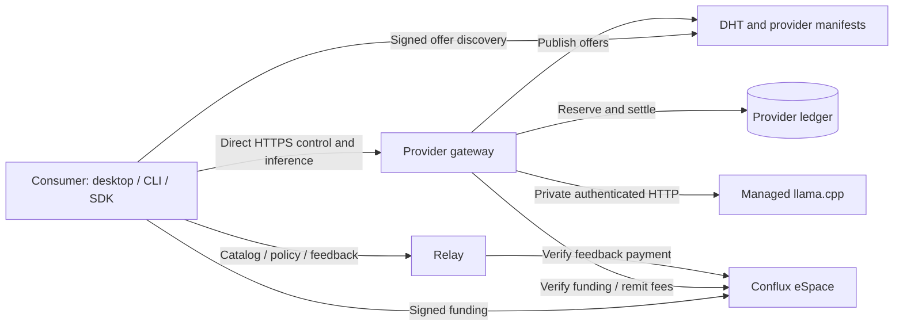

# Chiral Network: LLM inference exchange

This is the current design reference and white paper for Chiral. **GPU sharing means selling inference from a provider-operated model endpoint**, not renting a GPU VM, handing a customer shell access, or combining strangers' VRAM. A provider selects and runs a model; a consumer chooses that provider and pays for metered inference.

Part I explains the product, architecture and trust assumptions. Part II defines the implemented protocol, financial invariants and operational boundaries. The [provider qualification guide](provider-qualification.md) supplies executable installation/calibration procedures; the [Mac walkthrough](macos-testing.md) supplies a free local first test. The [migration plan](llm-serving-migration-plan.md) retains dated evidence and release gates, not a competing current design. Deployment-specific facts live in the [private zoo-6 runbook](zoo6-private-pilot.md).

## Contents

- [Part I: White paper](#part-i-white-paper): [direction](#direction-precedence-and-status), [product and trust](#product-and-trust-model), [architecture](#architecture-and-responsibilities), [engine choice](#why-llamacpp), [hardware participation](#hardware-participation-and-platform-status).
- [Part II: Design and implementation](#part-ii-design-and-implementation): [identities and signatures](#protocol-identities-signed-offers-and-canonical-bytes); [discovery](#discovery-freshness-withdrawal-and-live-state); [HTTP boundaries](#http-origins-and-trust-boundaries); [authorization and requests](#consumer-control-credentials-and-request-lifecycle); [reputation](#payment-gated-subjective-reputation); [configuration](#configuration-and-state); [funding](#agreements-and-exact-funding-order); [accounting](#durable-accounting-and-fees); [performance](#performance-accounting-and-withdrawal); [API compatibility](#api-compatibility-and-model-qualification); [provider lifecycle](#native-provider-provisioning-and-operations); [security and recovery](#listener-and-secret-boundaries); [release gates](#release-gates-and-source-map).

## Part I: White paper

### Direction, precedence, and status

**The implemented runtime is LLM inference only, settled with native CFX on Conflux eSpace testnet.** Chain ID **71**, genesis **`0x3fb9d350f95424c3c27fcf248d9a6f633a83c2a75c11ef887ea41540c85e7804`** are the selected identity. Chiral-coin is deferred; neither mainnet nor a new mining pool is authorized. Dynamic HF artifacts and evidence-bound performance/admission/waiver contracts are implemented, but **no GPU speed class or public release is qualified**. Historical storage/Drive/CDN/Core-Geth/in-app-mining guides are not current runtime instructions.

Current evidence includes live native eSpace funding/top-up recovery, on-chain platform fee arrival, stock Python/Node SDKs, native Linux desktop generation/accounting and failure recovery. **The user approved 8 GB capacity and dedicated zoo-6 to private inference testing; public rollout remains deferred.** The RTX 4060 has now served actual CFX-funded small-model requests. This limited GPU smoke is not a complete performance-qualification report. Earlier container evidence belongs to the historical chiral-coin stack; current GPU containers and supported-platform installers remain unqualified. See the plan's [dated execution evidence](llm-serving-migration-plan.md#14-execution-evidence-and-open-release-checklist).

### Product and trust model

Providers operate whole llama.cpp model endpoints on Windows, macOS or Linux, behind their own HTTPS gateways. Consumers discover signed offers, choose a provider, fund a small prepaid balance, and call a bounded OpenAI-compatible subset. Desktop, CLI and SDK clients share agreements and accounting. **llama.cpp is the only selected engine; the vLLM path is retired by this cutover.** The engine runs as a private managed subprocess, not embedded FFI. Models may span GPUs inside one provider's trusted network, **not arbitrary Internet peers**. Native desktop support does not remove public reachability or HTTPS requirements.

Three planes remain distinct:

- **Discovery:** libp2p/Kademlia indexes identify candidate peers; bounded manifest retrieval and a verified relay catalog yield signed offers. Consumers verify signatures, network, lifetime, and revision. Discovery is bounded and incomplete, not a census of all providers. A relay may omit an offer but cannot legitimately rewrite its signed price or payee.
- **Serving:** direct provider HTTPS/SSE. The gateway authenticates, validates, reserves, invokes a private model engine, and settles authoritative usage. The relay and blockchain do not carry prompts or model output.
- **Settlement:** separately operated Conflux eSpace RPC verifies native CFX funding. No blockchain transaction occurs per generated token. The application never starts a node or miner on login; Core mining payouts require an explicit Core-to-eSpace transfer before use.

**Risk disclosure:** provider balances are non-refundable, non-transferable between providers, and not escrow. A provider can disappear, refuse service, misrepresent a model, meter dishonestly, or fail to remit platform fees. Keep deposits small. The provider sees prompts and responses in plaintext at its endpoint; TLS does not hide them from the provider. Signed metadata and receipts prove who made a statement, **not model execution, correct inference, fair measurement, or confidential computing**. Testnet currency and payment-gated reputation are experimental and offer weak economic Sybil resistance.

### Architecture and responsibilities

The marketplace exchanges **model-specific service**, not ownership of hardware. Quantization, context length, capability, concurrency, price, memory kind and measured performance are separate properties. A larger GPU does not imply better model quality or a particular speed. Providers bear hardware, electricity, bandwidth and remittance-gas costs; token prices and testnet activity are not a profitability promise.



| Actor / component | Responsibility and authority boundary |
|---|---|
| Consumer | Holds its signing key locally, verifies offers/quotes, chooses a provider and privacy boundary, authorizes deposits, manages application credentials and checks receipts. |
| Provider gateway | Holds its own signing key, verifies funding, owns the account ledger and engine lifecycle, admits bounded work, meters usage and signs statements. It can still lie or disappear. |
| Private engine | Executes the pinned model and reports tokens/usage. It neither authenticates Chiral payers nor owns accounts, payments, reputation or wallet keys. |
| DHT and relay catalog | Discover signed candidate offers. Neither is an exhaustive directory, execution attestor, inference proxy or custodian. |
| Relay reputation service | Verifies and stores payment-gated feedback. This is a registry operated by the selected relay, not blockchain consensus over reputation. |
| Chain/RPC | Supplies identity-checked transaction/canonicality evidence. Settlement trusts the configured RPC's view within the application's acceptance policy; the chain does not verify tokens or model quality. |
| Policy authority / platform | Signs accepted client-version policy and receives provider-remitted fees. Its configured authority and fee wallet are explicit, not discovered from arbitrary peers. |

The native desktop and CLI share Rust consumer logic; SDKs use exported application credentials, not wallet private keys. Headless provider, relay and bounded RPC-gateway binaries are separately operated. Discovery may be decentralized without making metering, reputation availability, RPC evidence or version governance trustless.

The consumer workflow is: inspect a verified offer and current readiness/reputation, choose the exact model/provider/terms, inspect a signed quote, authorize small funding, wait for accepted credit, then call the provider directly. Inspect usage and request status before retrying an ambiguous operation; top up the same agreement deliberately. Switching providers requires another selection and account; neither prompts nor balances automatically follow it.

### Why llama.cpp

The selected tradeoff is native Windows/macOS/Linux participation, Apple Silicon Metal, small quantized GGUF models and direct control of an inspected native runtime. The earlier vLLM choice targeted Linux GPU serving and batching; its adapter is now retired. This is **not a claim that llama.cpp beats vLLM on throughput**. Any future comparison needs matched hardware, model, quantization, context, concurrency and correct billing; maintaining a second engine is not part of this design.

Chiral reuses the upstream server rather than implementing inference kernels or embedding C++ through FFI. Rust starts and supervises a pinned private `llama-server` subprocess, supplies explicit settings and verifies artifacts before use. Native operation needs no Python inference environment, Docker, WSL or separately operated model-manager service. Provisioning may use Python; it does not execute model-supplied Python.

The subprocess is a process-lifecycle and failure boundary, **not an OS security sandbox**. Running it under the same OS identity does not prevent that identity from reading accessible files. Keep installations trusted and inventory-verified; protect the host and keys. No automatic downloads, floating model updates or fallback engines are allowed at request time.

Multi-device configuration selects devices of the managed local runtime explicitly. Private operator-owned endpoints may exist inside one trusted provider network; that does not implement automatic multi-host scheduling, WAN tensor parallelism, cross-provider failover or customer-supplied code execution. Home NAT traversal, raw GPU rental, training, S3 and container-job submission are outside scope.

### Hardware participation and platform status

Capacity labels describe physical memory, not model fit, quality, throughput or available memory:

| Signed capacity tier | Minimum physical memory | Counting rule |
|---|---:|---|
| `8gb` | 7,500 MiB | Each selected dedicated device must meet the threshold. |
| `16gb` | 15,000 MiB | Each selected dedicated device must meet the threshold. |
| `32gb` | 30,000 MiB | Each selected dedicated device must meet the threshold. |
| `higher` | 45,000 MiB | May sum selected devices within the provider runtime. |

Apple unified memory is signed as `unified`, counted once as one device; dedicated GPU memory is signed as `dedicated`. The same tier threshold applies to the reported physical memory. Two 4 GB GPUs are not an `8gb` device. A 16 GB Apple Silicon Mac can be a `16gb` unified provider, but is not a 16 GB dedicated GPU: **at least 4,096 MiB headroom** is required for shared-memory operation, versus at least **256 MiB per dedicated device**. Headroom is subtracted from the fit budget, not the nominal capacity label. These checks are not an exclusive OS memory reservation.

Weights, KV cache, batching, context, concurrency, system RAM, loading overhead and competing processes affect fit. The managed launch allocates total context as **per-slot context × maximum concurrency**, disables automatic fitting/context shifting and does not silently reduce the contract to make a model fit. Small quantized models permit participation on constrained machines; a successfully loaded model is not yet a qualified paid speed class.

| Runtime path | Current evidence / limitation |
|---|---|
| Linux CUDA | Native private CPU/CUDA work and the zoo-6 RTX 4060 pilot are recorded; no qualified speed class or public release. |
| Windows CUDA | Native path implemented; Windows hardware execution and installer qualification remain open. |
| macOS Metal | Apple Silicon native path and first-test guide implemented; archive inspection on Linux is not a Metal execution result. Actual Mac qualification remains open. |
| Linux / Windows Vulkan | Execution path exists; the qualification runner rejects missing trustworthy per-device memory measurements. Do not advertise a speed qualification from runtime support alone. |
| CPU development | Useful for API/accounting smoke tests; system RAM and CPU throughput cannot establish a GPU capacity/speed badge. |

Cross-platform support is the current product decision, superseding the old Linux-only provider scope. It does not promise simultaneous public release or authorize public deployment: each OS/backend/model profile and installer must pass its own gates. Linux evidence cannot qualify Windows or Metal. Hardware/model license and redistribution rights remain operator obligations.

## Part II: Design and implementation

### Protocol identities, signed offers, and canonical bytes

This section defines the signed wire contract. Bounds below distinguish receiver validation from stricter local provisioning and qualification requirements. Schemas and equations are not instructions to broadcast payments.

#### Identity glossary

| Name | Exact role |
|---|---|
| `NetworkIdentity` | `{chain_id, genesis_hash, deployment_id}`. Equality of all three fields scopes offers, quotes, funding acknowledgements, receipts, feedback, discovery, and durable stores. Chain ID alone is insufficient. The network deployment ID separates resets/application deployments; it is not a provider ID. |
| Provider wallet | Canonical lowercase `0x` plus 40 hex digits. Signs commercial offers, quotes, funding acknowledgements and usage receipts; receives the consumer's opening/top-up payments. A signature establishes attribution, not honest execution. |
| Consumer wallet / payer | Signs control challenges and subjective feedback and supplies the funding transaction. Public knowledge of its address or transaction hash is not authority to operate its account. |
| Platform wallet | Signed destination of the provider's platform-fee obligation; distinct from the provider's inference engine credentials and administrator token. |
| `peer_id` | Persisted libp2p identity used to retrieve an authenticated manifest. The signed offer must name the peer that supplied it. It is not the wallet signing key. |
| Offer `deployment_id` | Provider deployment namespace, distinct from `network.deployment_id`. The current provider fills it with its persisted DHT peer ID. Together with provider wallet and model API ID it identifies an offer's revision stream. |
| Model `id` | Consumer-visible API model identifier, unique within one provider configuration. A name is not an artifact hash and alone does not specify execution terms. |
| Offer ID | `0x` plus lowercase Keccak-256 of the domain-framed canonical offer payload. It identifies one exact set of signed fields, including revision and validity times; it is not a permanent provider/account ID. |
| Quote / agreement / contract / account ID | The quote's random 32-byte `0x`-prefixed ID, reused for the prepaid account. “Contract” here means the signed commercial agreement and provider ledger account, not a newly deployed on-chain smart contract. |
| Request key / request ID | An account-scoped client idempotency key identifies an attempted inference operation; the ledger also has an opaque globally unique request identifier. Treat returned request IDs as opaque and retain the original key for uncertain requests. |
| Qualification identity | `{evidence_sha256, measured_at}` inside the serving profile. It attributes a measured report for one deployment; neither the report hash nor the provider's signature is independent hardware/model attestation. |

Money in signed/public JSON is an unsigned canonical decimal **base-unit string**, never a JSON float: `0` is valid, leading zeroes/signs/decimal points are not, and the implementation bounds money to `u128` (at most 39 decimal digits, with range checked). One CFX is `10^18` base units. Protocol timestamps are integer Unix seconds; revisions and capacity values are integer JSON numbers, not floating-point encodings. Implementations in languages with limited integer precision must preserve integer values exactly when processing signed JSON.

Sources: `src-tauri/src/protocol.rs:13–41,143–201,319–336,389–421`; `src-tauri/src/offer_registry.rs:31–51,271–294`; `src-tauri/src/app.rs:358–376`.

#### Signed offer schema

The wire envelope is `{"payload": <InferenceOffer>, "signature": <hex recoverable signature>}`. `Signed<T>`, `InferenceOffer`, `NetworkIdentity`, `ModelSpec`, price and serving-profile structures reject unknown fields. The field names below are the actual snake_case JSON names, not aliases.

| Offer payload field | Meaning / receiver validation |
|---|---|
| `network` | Complete `NetworkIdentity`, exactly equal to the selected network. |
| `provider_wallet` | Canonical provider wallet; recovered offer signer must equal it. |
| `peer_id` | Valid libp2p PeerId. DHT manifest receivers additionally require equality with the authenticated responding peer. |
| `deployment_id` | 1–128 ASCII letters, digits, `_` or `-`; current publisher uses `peer_id`. |
| `endpoint` | Public HTTPS origin on port 443, subject to the outbound-origin boundary below. No credentials, path prefix, query or fragment. |
| `model` | Immutable model and optional serving-profile schema below. |
| `price` | `{input_wei_per_1k, output_wei_per_1k}`; canonical decimal strings per 1,000 authoritative tokens. |
| `min_funding_wei` | Minimum opening funding for a paid offer. Current publisher emits `"0"` for a genuinely free offer. |
| `platform_wallet` | Canonical wallet to which the provider owes the platform fee. |
| `fee_bps` | Exactly `50` in this protocol release (0.5% of funding), not an open negotiated range. |
| `max_concurrency` | Integer 1–256; must equal serving-profile concurrency when a profile is present. It is not a guarantee that every caller will always obtain a slot. |
| `revision` | Positive `u64`, monotonic within provider-wallet/deployment/model namespace. |
| `issued_at`, `expires_at` | Integer Unix seconds. Receiver allows at most 30 seconds future issuance, requires unexpired `expires_at > issued_at`, and accepts at most a 3,600-second lifetime. Current publisher uses 120 seconds. |

`ModelSpec` contains exactly:

- `id`: nonempty API identifier, at most 256 bytes, no control characters;
- `revision`, `tokenizer_revision`: immutable content revisions, each 40 or 64 hexadecimal characters (not branch names);
- `chat_template_sha256`: 64 hexadecimal characters;
- `quantization`: nullable string; when present, nonempty and at most 64 bytes;
- `context_length`: 1–1,048,576 tokens;
- `max_output_tokens`: no greater than context length; positive when `chat` or `completions` is advertised and zero for a nongenerating model;
- `capabilities`: 1–6 unique members of `chat`, `completions`, `embeddings`, `tools`, `structured_output`, `streaming`, including at least one of the first three inference endpoints;
- `serving`: nullable `ServingProfile`. Absence is not a speed/capacity claim. Production provider configuration rejects generation without a qualified profile; explicit development/calibration is a separate path, not paid-service qualification. Basic signature/offer validation alone does not independently prove that a remote provider completed qualification.

`ServingProfile` carries all of the following, and all are covered by the offer, quote and receipt signatures:

| Group | Fields |
|---|---|
| Artifact | `hf_repo`, `tokenizer_repo`, `artifact_manifest_sha256` |
| Runtime | `engine`, `engine_version`, `runtime_sha256`, `platform`, `backend` |
| Physical inventory | `memory_kind`, `devices`, `memory_reserve_mib` |
| Execution settings | `gpu_layers`, `split_mode`, `tensor_split`, `cache_type_k`, `cache_type_v`, `flash_attention`, `batch_size`, `ubatch_size` |
| Admission/performance | `capacity_tier`, `region`, `max_concurrency`, `arrival_milli_rps`, `output_tokens_per_second`, `policy` |
| Evidence | `qualification: {evidence_sha256, measured_at}` |

Each `devices` entry is `{id, name, memory_mib, driver_version, engine_device}`. Memory is a physical inventory claim; unified memory is not added again for every device. `policy` and the performance chapter define the qualifying workload and waiver, not an unrestricted Internet latency SLA. Profile consistency is checked by `performance::validate_profile`; current-time validation rejects qualification measurement in the future. Signing a field does not independently verify its real-world truth.

Source of exact types and validation: `src-tauri/src/protocol.rs:13–181`; `src-tauri/src/offer_registry.rs::validate_model`, `OfferRegistry::insert_at` (`52–115,245–292`); `src-tauri/src/provider_config.rs:118–141`. Keep the serving-profile field list synchronized with `protocol.rs::ServingProfile`, not a manually invented alternate wire format.

#### Canonical encoding, domains, signatures and commitments

The byte contract is deliberately narrower than arbitrary RFC 8785 JSON canonicalization:

1. Serialize the typed value to `serde_json::Value`. Recursively reject numeric values that are neither signed nor unsigned integers. `serde_json::Map` uses its default sorted map representation: object keys are sorted recursively; array order remains significant. Serialize compact UTF-8 JSON using `serde_json::to_vec`, without extra whitespace. The `preserve_order` feature must not replace that map behavior. Null optional fields are part of the typed serialization. Cross-language implementations must reproduce this encoder's string escaping and integer representation; use `protocol.rs::canonical_json` as the exact reference, rather than assuming any “sorted JSON” library is interchangeable.
2. For domain `D` and canonical bytes `J`, build `P = u32_be(byte_length(D)) || UTF8(D) || u32_be(byte_length(J)) || J`. Lengths count bytes. There is no trailing NUL, newline or JSON envelope included in `P`.
3. Sign `Keccak256(0x19 || "Ethereum Signed Message:\n" || ASCII(decimal byte_length(P)) || P)` with recoverable secp256k1 ECDSA. The signature is compact 32-byte `r`, 32-byte `s`, then recovery byte 27 or 28; signer emits 130 lowercase hex characters without `0x`. Verification accepts an optional `0x`, requires 65 decoded bytes, accepts only recovery parity 0/1 after subtracting 27, rejects high-`s`, recovers the canonical wallet, and compares it to the required signer.
4. Object IDs and payment commitments hash `P` directly with **Keccak-256**, not SHA-256 and not the personal-sign prefixed digest. Explicitly named artifact/evidence `sha256` fields use their separately defined SHA-256 contracts.

`hash_hex(bytes)` below means `"0x" + lowercase_hex(Keccak256(bytes))`. It is not the SHA-256 hash of JSON or a signature.

Domains are exact ASCII strings:

| Payload | Domain | Signer |
|---|---|---|
| Offer | `chiral-inference-offer-v1` | Provider |
| Quote | `chiral-inference-quote-v1` | Provider |
| Funding-intent acknowledgement | `chiral-inference-funding-intent-v1` | Provider |
| Usage receipt | `chiral-inference-receipt-v1` | Provider |
| Control challenge | `chiral-inference-auth-v1` | Payer |
| Subjective feedback | `chiral-inference-feedback-v1` | Payer |

`offer_id = "0x" || lowercase_hex(Keccak256(P_offer))`. Opening transaction data is the six literal bytes `CHRL1\0` followed by `Keccak256(P_quote)` (38 bytes total). Top-up data is `CHRL2\0` followed by the 32 decoded bytes of the account ID (also 38 bytes). An opening therefore commits to the entire immutable quote, including full network, parties, model/profile, rates, funding, platform fee, concurrency, nonce and validity. Domain separation prevents interpreting an offer signature as a feedback or control signature.

Exact byte references: `src-tauri/src/protocol.rs:6–11,326–414`; `src-tauri/src/wallet.rs:216–275`. These functions, not prose approximations of Ethereum signing, are the interoperation reference. Cross-language test vectors are not supplied by this section; no interoperability run is claimed here.

### Discovery, freshness, withdrawal, and live state

#### Bounded DHT and manifest discovery

Kademlia advertises **candidate peers**, not trusted arbitrary offer blobs. Current DHT storage disables ordinary value records (`max_records = 0`); a peer serves its own bounded manifest over a separate authenticated request-response stream. The provider wallet's signature supplies commercial authenticity, while libp2p authenticates the responding peer.

Network scoping and wire formats are explicit:

- `scope = hash_hex(canonical_json(network))`; Kademlia protocol is `/chiral/inference/kad/1/{scope}`, Identify protocol is `/chiral/inference/id/1/{scope}`.
- An index key is `Keccak256(canonical_json([network, model_selector]))`, where `model_selector` is `null` for all models or the exact model-ID string. This tuple/array encoding is distinct from the signed-object domain frame.
- Manifest protocol is `/chiral/inference/manifest/1`. Request is `{network, model, offset}`; response is `{offers, next}`. Each direction has a four-byte big-endian JSON-byte length followed by JSON. Maximum request frame is 2,048 bytes; response frame 262,144 bytes.
- A manifest contains at most 64 locally published offers, paged in groups of 8. Request offsets are aligned multiples of 8 below 64. Follow `next` only when it equals the previous offset plus 8. Each signed offer is independently bounded to 16 KiB and validated before registry insertion.
- A search has an 8-second collection window, samples at most 64 distinct peers, and admits at most four simultaneous searches per DHT service. Manifest RPC timeout is 4 seconds. The public `discover` caller has a 10-second response wait, not a guarantee that connection/bootstrap plus the whole application operation completes in 8 seconds. Connected bootstrap peers are also candidates, never authorities.
- Provider records have a 600-second TTL and a 120-second publication interval; these are **not** the signed-offer lifetime. Bootstrap is retried every 30 seconds. At most 32 bootstrap multiaddresses are configured, each ending in `/p2p/<peer-id>` at startup.

The search merges verified responses until its deadline rather than taking the first answer as the marketplace. Bad signatures, malformed offers, mismatched network/model/peer identities or failed replies do not prevent independent peers from contributing. Results include matching unexpired entries in that service's verified registry; a long-running relay can therefore include previously verified cached offers as well as this search's replies. The registry holds at most 8,192 namespace entries. Bounds and adversarial peers make discovery incomplete: absence is not proof that no provider exists, nor does a first reply establish market-best price or quality.

Sources: `src-tauri/src/dht.rs:24–36,49–131,213–247,279–363,378–434,435–557`; `src-tauri/src/offer_registry.rs:11–18,245–330`.

#### Revision and withdrawal semantics

The registry namespace is `provider_wallet/deployment_id/model.id`. A higher revision replaces its predecessor; a lower revision is rejected. Equal revision with different content is equivocation and rejected. Replaying an identical still-present offer is idempotent and does not extend the revision-retention horizon. Withdrawal removes the content-ID lookup but preserves the revision watermark/tombstone; replay of the same withdrawn revision is rejected. Watermarks are retained until 3,630 seconds after the accepted update was first observed, bounding memory while covering the maximum allowed lifetime plus issuance skew. This is local in-memory anti-rollback state, not a globally persistent consensus log. Consumers create a fresh verification registry for each discovery call; do not describe revision comparison as permanent cross-session consensus.

A peer's complete valid authenticated manifest may withdraw **that peer's** previously cached offers omitted from the requested model scope. Partial or invalid manifests do not authorize deletion. Expiry also removes offers from visible results. Provider local withdrawal stops advertising indexes when they have no remaining local offers, but it does not instantly erase already distributed provider records or every remote cache. Remote disappearance is bounded by refreshed complete manifests and signed expiry, not an instantaneous global revocation broadcast.

The current provider persists its revision counter, refreshes nominally every 30 seconds, and publishes 120-second offers only for models currently acceptable for publication. Development models without a serving profile are kept local to that provider's registry rather than announced through the DHT. Preserve the provider's DHT identity, durable revision, ledger and keys: deleting them is not recovery.

Sources: `src-tauri/src/offer_registry.rs:225–340`; `src-tauri/src/dht.rs:409–434,453–489,523–545`; `src-tauri/src/app.rs:219–254,347–396,418–438`.

#### Catalog precedence and catalog-specific reputation

`Consumer::discover` chooses **direct DHT when `dht` is configured**. It does not merge catalog offers into those results and does not silently fall back to `catalog_url` when DHT discovery fails or returns no offers. Only when DHT is absent does it use the configured catalog origin. If neither is configured, discovery errors.

Catalog offer API is `GET /api/offers?offset=0&limit=50` with optional exact `model` filter, returning `{offers: [Signed<InferenceOffer>, ...], next_offset: number|null}`. Server limit defaults to 50 and must be 1–100; offset is at most 8,192. The native consumer requests 50 per page, independently verifies every offer, rejects oversized pages and nonincreasing/cyclic pagination, and stops after at most 100 pages (otherwise asks the user to narrow the model filter). The relay refreshes its verified registry through DHT every 15 seconds. Pagination is a view over a changing bounded registry, not a snapshot-isolated exhaustive crawl.

A configured `catalog_url` has a **separate role** even when DHT takes discovery precedence: native provider inspection reads reputation there, and feedback is submitted there. DHT does not transport reputation events/snapshots. Without a configured catalog, offers can still be discovered over DHT but reputation is explicitly unavailable and native feedback submission errors. The catalog's snapshot is a catalog-served calculation, not a provider-signed score or global consensus. This release exposes no feedback replication/merge protocol guaranteeing that distinct catalog operators have the same event set.

Sources: `src-tauri/src/consumer.rs:373–430,628–698,1786–1827`; `src-tauri/src/bin/relay_server.rs:46–95,210–245`.

#### Immutable terms versus current availability

An offer is an attributable proposal at its issue time, not a health certificate. `GET /healthz` reports process liveness; `GET /readyz` returns `{ready, funding_ready}` with HTTP 200 or 503 based on serving readiness. **Serving readiness is deliberately separate from new-funding readiness.** A temporary chain outage can pause new funding/publication while existing settled balances remain usable; wrong-network evidence, administrative drain, runtime failure, unqualified models or durable performance withdrawal can prevent admission. Provider-wide readiness is not proof that every model has a free slot. Model-specific qualification and concurrency are checked again at execution.

Native inspection returns `observed_at`, point-in-time health/readiness observations, and a separately fetched reputation result. Its readiness summary presently exposes `ready`, not the separate raw `funding_ready` field. Clients needing that distinction must interpret the provider's `/readyz` response; they must not infer it from the desktop summary. Readiness observations are unsigned HTTPS responses and do not change signed prices, account balances or agreement terms.

Quotes copy exact selected offer model/profile, rates, fee terms and concurrency, bind the payer and provider, specify funding and a random nonce, and currently expire 300 seconds after issuance. Once accepted funding terms are durably acknowledged, offer refresh/expiry cannot renegotiate them. For existing accounts the sole supported evidence substitution is a strictly newer qualification measurement of an otherwise identical model/deployment profile; it does not replace prices, funds or other terms. Readiness/withdrawal gates admission, not the existence of an old agreement or settlement recovery.

The [approved non-reserving quote decision](#approved-non-reserving-quotes) permits more outstanding quotes than the provider can accept for funding. It changes the quote/admission contract, not accepted financial obligations; implementation and specification alignment remain pending.

Sources: `src-tauri/src/app.rs:54–70,256–396,477–482`; `src-tauri/src/protocol.rs::ModelSpec::accepts_execution`, `ServingProfile::same_terms` (`44–140`); `src-tauri/src/contracts.rs:245–297,314–345,366–412,476–504`; `src-tauri/src/consumer.rs:237–263,373–430,699–745`.

### HTTP origins and trust boundaries

Remote provider/catalog origins must be public HTTPS on port 443. Validation rejects username/password, query, fragment, non-root paths, loopback, `.localhost`, single-label remote hostnames, and forbidden literal addresses. A `development` exception allows HTTP(S)/non-443 only for literal loopback or exact `localhost`; it does **not** authorize arbitrary private LAN endpoints or remote cleartext HTTP. Development provider public listeners themselves must bind loopback.

Advertise `https://provider.example`, not `https://provider.example/v1` or `https://provider.example:8443`. An OpenAI SDK's `base_url` adds `/v1` **after** validating the provider origin; a catalog URL is its origin, not `/api/offers`.

Before connecting, `safe_http_client` resolves the validated origin once under a five-second DNS deadline, inspects up to 33 answers, and rejects an empty answer set, more than 32 answers, or **any** disallowed result. Accepted addresses are pinned into that client. It disables environment proxies and all redirect following and sets a ten-second connect timeout. Construct the client for each validated origin; do not reuse it for arbitrary hosts. Resolving again when a later client is built repeats validation; DNS pinning is not certificate pinning and does not claim a stable IP forever. HTTPS still supplies its normal certificate/hostname verification. A provider-controlled redirect is not authorization to send secrets to its target.

The public address predicate excludes IPv4 private, loopback, link-local, multicast, broadcast, unspecified, CGNAT, benchmark/documentation and selected special-use ranges; IPv4-mapped IPv6 is subjected to the IPv4 predicate. IPv6 must satisfy the implemented global-unicast filter, excluding the documented transition/documentation/special ranges. Treat `offer_registry.rs::public_ip` as the exact predicate, not a promise to classify every future IANA allocation. This boundary protects outbound HTTP requests; it is not a claim that all libp2p addresses obey the HTTP-origin policy.

Provider administration and engine traffic have different authorization/boundaries:

- Administration is on a distinct nonzero **loopback-only** listener with its protected administrator bearer. `/admin/*` is not mounted in the public router. An account bearer or wallet control challenge is not an admin token.
- The inference engine URL is private operator configuration, not the advertised endpoint. It must be an HTTP(S) origin on literal loopback/private IPv4, IPv6 loopback/unique-local, or exact `localhost`. A named arbitrary internal DNS hostname is not accepted by current validation. The current managed llama.cpp subprocess is private; engine credentials are distinct from account/admin/wallet secrets. Private-engine clients disable proxies and redirects as well.
- A TLS reverse proxy may front the public provider listener, but must not expose the loopback administration listener, private engine, credentials or filesystem. Public HTTPS reachability is still required; libp2p relay support does not turn the inference HTTP endpoint into NAT traversal.

Sources: `src-tauri/src/offer_registry.rs:117–216`; `src-tauri/src/provider_config.rs:91–103,143–160,190–211`; `src-tauri/src/app.rs:440–470,540–562`; `src-tauri/src/inference_backend.rs:527–549`.

### Consumer control, credentials, and request lifecycle

#### Authorization matrix

| Operation | Current authorization |
|---|---|
| `POST /v1/auth/challenge` | Public bounded challenge issuance; issuing a challenge does not authorize an account. |
| `POST /v1/contracts/propose` | Public proposal for an unexpired local offer. **This endpoint is not owner-authenticated.** Naming a consumer does not prove wallet control or authorize payment. See [approved non-reserving quotes](#approved-non-reserving-quotes) for the selected admission design and current implementation gap. |
| `POST /v1/contracts/:id/funding-intent`, `POST /v1/contracts/open` | One-use payer challenge; quote must belong to that wallet. Signed raw transaction evidence is additional payment proof, not a replacement for owner authorization. |
| `POST /v1/contracts/:id/topup` | One-use account-owner challenge and exact original signed payment evidence. |
| `GET /v1/contracts/:id` and `/receipt`, `/funding`, `/requests`, `/requests/:request_id`, `/credentials` | Owner challenge **or** bearer with `read` scope belonging to that account. GET bodies must be empty. Request list accepts only optional `before=<unix_seconds>`. |
| `POST /v1/contracts/:id/credentials`; `DELETE /v1/contracts/:id/credentials/:credential_id`; `POST /v1/contracts/:id/credentials/:credential_id/rotate` | Owner challenge; a read/infer bearer cannot mint, rotate or revoke credentials. |
| `GET /v1/models`; `POST /v1/chat/completions`, `/v1/completions`, `/v1/embeddings` | Account bearer with inference authorization; listing/capabilities are account/model scoped, not the public marketplace. |
| `GET /v1/requests/:id` | Account bearer with `read` scope. |
| `POST /v1/requests/:id/cancel` | Account bearer with `infer` scope. |

Owner-proof exchange: send `{wallet, method, path, body_hash}` to `/v1/auth/challenge`, where `body_hash = hash_hex(exact outgoing body bytes)` and `path` includes the exact query when present. Response is `{nonce, payload_hex, expires_at}`. The challenge has a 120-second lifetime and signs `{network, provider_wallet, wallet, method, path, body_hash, nonce, expires_at}` using the auth domain. Reconstruct/verify the returned bytes against the intended request before signing; never sign arbitrary server-provided bytes blindly. Submit the operation with `X-Chiral-Owner`, `X-Chiral-Nonce`, `X-Chiral-Signature` and the exact body. The ledger atomically consumes the one-use challenge after signature/binding checks. A retry requires a fresh proof but retains the same account/payment operation; the old stateless `X-Owner-Sig` scheme is not this protocol.

The current public middleware checks `X-Chiral-Client-Version` when provided; native onboarding supplies it. It is not required from ordinary stock inference clients. This is not a universal guarantee that missing-version requests are rejected. Control bodies are limited to 96 KiB with a five-second body deadline and 64 concurrent control slots.

Credential issuance accepts `{expires_at, spend_cap_wei, max_concurrency, scopes}`; scopes are `infer` and/or `read`, spend cap is nullable canonical base-unit money, and credential concurrency cannot exceed its account. Provider stores token hashes, not plaintext tokens. The returned credential secret is separate from its public metadata ID; keep it only in protected native storage and export intentionally for an application. Normal native credential management outputs metadata rather than printing secrets. A credential cap limits authority on the same prepaid balance; it is not a new balance or refund guarantee. Do not put tokens/private keys on command lines, into prompts or in diagnostics.

Sources: `src-tauri/src/contracts.rs:25–51,86–176,177–243,245–537`; `src-tauri/src/auth.rs:9–111`; `src-tauri/src/consumer.rs:789–834,1432–1560`; `src-tauri/src/billing_store.rs:35–57,757–809`; `src-tauri/src/inference_gateway.rs:145–172,242–303`; `src-tauri/src/app.rs:506–538`.

#### Request and account integration

Follow [the exact funding order](#agreements-and-exact-funding-order) for paid onboarding. Free sessions still require authentication and admission, but no fabricated transfer; they cannot vote.

For inference, use a stable `Idempotency-Key` before dispatch. Current keys allow 1–128 ASCII letters/digits or `. _ : -`; absent a key the gateway generates a new UUID, which does not let an application safely recover a previously lost request. The account isolates the key. A duplicate returns HTTP 409 `duplicate_request` with request ID/status; it does **not** replay generation or recover saved response text. Response content is not retained for replay. Keep `x-request-id`, inspect the account's status/request/receipt history after uncertainty, and do not issue a new chargeable operation just because the output stream was interrupted.

Admission, exact token preparation, maximum-cost reservation, execution, authoritative-usage settlement, performance waiver and unknown-usage release are separate stages. Account and credential limits are enforced against the same ledger. Cancellation requests signal the live operation and may return 202 `cancelling`; that does not mean already generated work is free. Known usage can still settle; missing/invalid authoritative usage uses the explicit unknown-usage policy rather than invented token counts. Stream fragments, visible text length and client receipt of the last event are not authoritative billing evidence.

Signed receipts contain `{network, provider_wallet, account, requests, sequence, issued_at}` and cover a bounded recent request page, including recorded performance outcomes. A receipt is an attributable provider accounting statement, not complete prompt/output storage, an on-chain proof of execution, or an automatic dispute/refund mechanism. Preserve prior verified receipts if an application needs its own history. Receipt/account reads, top-up settlement and credential recovery are not renegotiation of the original model/pricing contract.

Sources: `src-tauri/src/protocol.rs:183–218,234–279`; `src-tauri/src/contracts.rs:299–412,414–504`; `src-tauri/src/inference_gateway.rs:174–210,260–303`; `src-tauri/src/consumer.rs::fund`, `resume`, `receipt`, `request_status`, `cancel_request`.

### Payment-gated subjective reputation

#### Evidence, admission, and endpoints

This release implements **payer-signed subjective feedback backed by the quote's opening payment**. It does not require a completed inference request, usage receipt, minimum token count, duration, provider's acknowledgement, or proof that the provider's model was correct. It is not the retired transfer-success rating endpoint. Faucet-funded identities, colluding wallets and multiple paid agreements remain economic/Sybil limitations; self-feedback by the same payer/provider address is specifically forbidden, not all beneficial-owner overlap.

The catalog exposes:

- `POST /api/ratings/feedback` with `FeedbackSubmission`;
- `GET /api/ratings/:wallet` returning `{network, provider_wallet, experimental_testnet: true, elo, base_elo: 50.0, vote_count}`.

There is no current batch-rating endpoint or public event-history endpoint in this router. POST success is `{accepted: true, quote_id, revision, experimental_testnet: true}`. Requests are bounded to 64 KiB; four verification slots are shared by submission, reads and background reconciliation.

`FeedbackSubmission` is exactly:

```text
{
  feedback: Signed<{
    network,
    provider_wallet,
    consumer_wallet,
    quote_id,
    tx_hash,
    score,
    revision,
    issued_at
  }>,
  quote: Signed<Quote>,
  raw_transaction: <original signed opening transaction hex>
}
```

It carries no prompt text, explanation/comment, top-up list or client-reported transfer outcome. Score is an integer 0–100, consumed as `score / 100`; the code does not impose finer category labels such as stars. `revision` is positive. The feedback signature must recover the consumer and the quote signature the provider using their respective domains. Full network identities must match the catalog. Provider, consumer and quote ID must match the quote; consumer and provider must differ. Wallets and `tx_hash`, `quote_id`, `offer_id` are canonical lowercase hex. Feedback cannot predate quote issuance, be more than 30 seconds in the future, or arrive more than 300 seconds after its signed timestamp. Quote expiry must follow issuance, concurrency must be positive, fee must be 50 bps, and the model must pass validation. The quote need not remain unexpired when a later vote is submitted.

Free sessions cannot vote: quote funding must be positive and at least one quoted token rate nonzero. Raw transaction evidence is at most 32,768 characters. Catalog verification independently decodes the signed payment, checks network/chain, payer, provider recipient, **exact quoted funding amount**, exact `CHRL1\0 || quote commitment`, and matching transaction hash. It then requires successful canonical execution at or below the healthy eSpace safe frontier, observed consistently twice. `safe` is the application settlement policy, not irreversible PoS finality. A bare tx hash, arbitrary payment to that provider, top-up commitment, failed transaction, pending transaction or free quote is insufficient.

The native `feedback` operation reads the saved original opening payment and signed quote, signs current feedback locally, and sends it to the configured catalog. Catalog credentials are not provider account bearers, and the feedback route uses the submission's payer signature rather than an inference owner-challenge exchange. Sending the original **already signed** payment bytes exposes payment evidence; it never requires sending the payer private key. Do not print raw evidence as a diagnostic shortcut.

Sources: `src-tauri/src/reputation.rs:9–90`; `src-tauri/src/rating_api.rs:24–52,85–175`; `src-tauri/src/chain_client.rs:774–852`; `src-tauri/src/consumer.rs:1786–1827`.

#### Replacement, deduplication, and bounded persistence

The SQLite store is bound to the entire network identity and refuses reuse on a different network. It has one row per quote/account (`quote_id` primary key) and a unique opening `tx_hash`; one payment cannot create votes for multiple agreements. A valid vote update replaces the row rather than adding another weight. Both revision **and** `issued_at` must strictly increase for changed evidence; same revision with different evidence is rejected. Identical same-revision stored evidence is idempotent after current admission/chain checks, and can restore eligibility. The old 300-second submission must nevertheless be freshly revised for a later POST rather than bypassing admission freshness.

An agreement cannot change its opening payment hash or verified amount. First-accepted `created_at` and verified amount are preserved across updates, so score editing does not rejuvenate its age or increase its amount weight. The store currently caps 100,000 total feedback rows and 1,000 per provider. These are storage/admission bounds, not a promise of automatic expiry/pruning or an unlimited public registry. Each independently operated catalog holds its own such store.

Sources: `src-tauri/src/rating_storage.rs:15–152`; `src-tauri/src/rating_api.rs:103–145`.

#### Exact amount/time-weighted Elo calculation

Start from `E = 50`. Select eligible rows in the exact network and provider scope whose **first-acceptance age** is at most 180 days. Order ascending by `(created_at, quote_id)`; this deterministic tie-break matters because updates are sequential. For each row, let:

```text
age_days = max(0, now - created_at) / 86400
w_time   = max(0, 1 - age_days / 180)
amount   = verified_opening_amount_wei / 10^18
w_amount = 1 + clamp(ln(1 + amount) / ln(51), 0, 1)
signal   = score / 100
expected = 1 / (1 + 10^((50 - E) / 12))
E        = clamp(E + 4 * w_time * w_amount * (signal - expected), 0, 100)
```

The amount weight uses the gross canonical opening value in CFX, **not** token spend, balance, net credit after fee, cumulative top-ups or the user's claimed amount. It ranges from 1 to 2 and reaches its cap at 50 CFX. Time weight decays linearly; votes exactly 180 days old still count in `vote_count` but have zero incremental weight. Updates replace the subjective signal at its original position/age. Round final `E` to one decimal place; `base_elo` stays 50, and `vote_count` counts the selected eligible rows. No votes yields the neutral baseline, not a successful service history. This rating arithmetic uses `f64`; it is separate from exact integer monetary settlement.

Source: `src-tauri/src/reputation.rs:92–152`.

#### RPC failures, reorgs, and what “unavailable” means

Before returning a provider's snapshot, the catalog revalidates stored provider/payer signatures and the opening payments. Invalid evidence, rejected execution or pending/noncanonical payment makes a row ineligible. The evidence is retained so a later canonical recovery may restore eligibility. A missing receipt is treated as pending for this rating verification and removes the vote from the current score; that is **not** proof of a ledger funding reversal and must not be described as such. The funding ledger's stricter reversal rules remain separate.

If required RPC evidence is unavailable, a snapshot fails with HTTP 503 `chain_unavailable` rather than serving a known-stale score; a 30-second verification/revalidation deadline produces 503 `chain_timeout`. Submission of pending evidence gives 409 `payment_pending`; rejected evidence gives 400 `payment_rejected`. Busy verification gives 429 `feedback_busy`; invalid/stale/conflicting submissions return the corresponding `invalid_feedback`, `expired_feedback` or `feedback_conflict` errors. Background reconciliation visits providers in bounded pages of 32, nominally every 30 seconds, reusing the same validation and preserving orphaned evidence. This is not a fixed global revalidation completion bound.

Native provider inspection displays reputation unavailability separately from liveness/readiness; it must not replace an unavailable score with fabricated zero/baseline or imply the provider is untrustworthy solely because a catalog/RPC is down. A returned neutral baseline reflects no eligible history in that catalog, not universal absence of payments. No ranking authority, slashing, escrow, automatic refund or automatic rerouting follows from this score.

Sources: `src-tauri/src/rating_api.rs:53–83,96–175,176–206`; `src-tauri/src/rating_storage.rs:135–151`; `src-tauri/src/consumer.rs:408–430`.

### Configuration and state

There are no implicit chain presets, bootstrap addresses, faucet authorities, or legacy RPC fallbacks. JSON configurations reject unknown fields. Paths in consumer/provider configurations are resolved relative to their configuration file. Select a profile deliberately in native desktop Settings or use `chiral --config consumer.json`.

A consumer profile has these fields (use real operator-supplied values, not guessed public endpoints):

| Field | Meaning |
|---|---|
| `network.identity.chain_id` | `71`, selected Conflux eSpace testnet |
| `network.identity.genesis_hash` | `0x3fb9d350f95424c3c27fcf248d9a6f633a83c2a75c11ef887ea41540c85e7804` |
| `network.identity.deployment_id` | Reset/deployment name, 1–128 ASCII letters, digits, `_` or `-` |
| `network.rpc_url` | Qualified RPC endpoint; HTTPS remotely, literal-loopback HTTP only for local operation |
| `network.rpc_bearer_file` | Optional protected RPC bearer file; never put a token in the URL |
| `network.faucet_url`, `explorer_url`, `policy_url` | Optional operator-supplied endpoints; `null` if not deployed |
| `data_dir` | Protected persistent **shared signing-wallet journal base**, described below |
| `catalog_url` | Relay origin, not `/api/offers`; used for offer discovery only when `dht` is absent, and independently for reputation/feedback |
| `development` | Defaults false; enables explicit loopback-only consumer/provider HTTP development |
| `dht` | Optional `{listen, bootstrap, identity_file}`; configured DHT takes discovery precedence without catalog fallback; `bootstrap` lists peer multiaddresses |

Use an operator-provided profile with this exact identity and a deliberate deployment namespace. The historical isolated chiral-coin identity in the plan is not a current profile. Remote RPC identity is checked against chain ID and genesis; deployment identity additionally scopes records and local state. Do not reuse a deployment namespace after a reset. CFX uses `10^18` wei per unit; amounts on JSON boundaries are decimal strings, not floating-point numbers. The public eSpace network does not imply a released Chiral catalog/provider.

#### Shared signing-wallet directory

Every process spending the **same signing wallet** on a network—including consumer funding and provider fee remittance—must use the **same configured `data_dir` base** and coordinated journal. `ChainClient` adds `inference/<hash-of-full-network-identity>/wallet-journal/transactions.sqlite3`. Do not pre-append that suffix, give each process a different copy, or put different copies on separate hosts. The nonce journal's interprocess locking cannot coordinate independent databases. Prefer distinct provider and consumer wallets when their storage cannot be shared safely.

Provider ledger, lock, and offer-revision state are separately isolated as `<data_dir>/<network-hash>/<signing-wallet>/<DHT-peer-ID>/`; the shared nonce journal above is **not** moved into that deployment directory. Consumer accounts, credentials, request keys, and wallet state are also network-scoped. Different provider deployments need distinct persistent DHT identities but must still share the wallet journal when spending the same wallet. Preserve the DHT identity along with ledger, acknowledgements, offer revision, wallet journal, keys and credentials across restarts; a new peer ID creates a different deployment, not recovery of its predecessor. This is not shared multi-host SQLite. Changing paths or restoring an older layout without deliberate state preservation is not an upgrade strategy.

Wallet keys are native protected files, not JavaScript state or public HTTP responses. CLI wallet import/export accepts protected file paths; explicit export refuses to overwrite existing files. Unix secrets must not be group/world accessible; native Windows uses owner-protected storage. Provider signing, admin, engine, and RPC credentials are separate protected files. Do not place private keys or bearer tokens on command lines, in prompts, source control, diagnostics, or screenshots. Explicit credential export reveals an API secret; SDK examples capture it in-process and never print it. Back up sensitive state with equally protected access.

### Agreements and exact funding order

The [authorization matrix](#authorization-matrix) defines the control routes and their different authentication requirements.

Owner-authorized operations use a one-use payer-signed challenge bound to provider/network, method/path, body hash, nonce, and expiry; public quote proposal does not require that proof. Possession of a public transaction hash is not owner authentication. Quotes bind consumer/provider, model revision and capabilities, prices, limits, fee wallet/rate, network, funding amount, nonce, and expiry. Opening a paid account follows this order:

1. Verify the selected signed offer and quote and persist the selected terms locally.
2. Prepare and durably journal **one exact signed opening transaction**, including its terms commitment in calldata, nonce, value, intrinsic gas, and hash. It has not yet been broadcast by the client.
3. Submit those signed bytes through payer-authenticated `funding-intent`. The provider validates them and atomically stores the intent and signed acknowledgement **before returning the acknowledgement**. New intents must be registered before quote expiry.
4. The consumer verifies the acknowledgement's provider signature and exact quote/network/payer/hash binding, then durably saves it. Accepted terms survive quote expiry; retries recover the same acknowledgement.
5. Only then does the client mark broadcast started durably and broadcast the **original bytes**. An uncertain broadcast never authorizes preparing a replacement payment automatically.
6. The provider credits through authenticated open only after independently checking signed-byte evidence and stable successful canonical execution at the healthy eSpace `safe` frontier. Pending or executed-but-not-safe transactions are not spendable credit.

**Residual registration risk:** signed bytes are already sufficient for anyone holding them to broadcast. A malicious provider may broadcast before acknowledging, or an acknowledgement may be lost after durable acceptance. The ordering protects the honest client's behavior and durable terms; it is not cryptographic escrow. Inspect `pending` and `resume CONTRACT_ID`, never assume an HTTP error means no money moved.

An acknowledged opening retains its signed quote, exact raw payment and signed acknowledgement durably. Quote expiry releases its temporary admission lease, not the obligation to honor an accepted payment. New opening intents require the payer's current nonce and enough balance for value plus the transaction's full gas limit; nonce ownership remains durable across terminal outcomes and reorg recovery.

`fund` with the same signed terms and `resume` recover the existing locally saved account; they must not rotate its exported application credentials. The previously observed rotation regression and its verification status are tracked in [bugs](bugs.md). Explicit credential rotation/revocation remains intentional. Top-ups bind the existing immutable agreement, journal their original payment, and deduplicate it; they do not renegotiate a new quote or require another opening-intent acknowledgement. Free offers authenticate and apply admission limits but require no fabricated zero-value transfer and cannot establish payment-gated reputation eligibility.

Settlement of an existing top-up remains available when the engine is unavailable or its offer has been withdrawn: readiness gates new admission, not recovery of a previously funded immutable agreement. Repeated settlement cannot credit twice. If the default credential has expired or been revoked, `resume` does not silently replace it; explicitly issue or rotate a credential. Issuing a key restores a missing usable default without replacing an existing valid default.

#### Approved non-reserving quotes

**Author decision, 2026-11-14; implementation and specification alignment pending.** Providers may issue more quotes than they can accept for funding. A quote is a signed statement of exact commercial terms, not a capacity reservation or a promise to admit its payment. This decision supersedes conflicting pending-proposal and proposal-rate requirements; it does not claim that the current implementation already complies.

- **Public quoting does not reserve admission.** An unauthenticated proposal must not occupy serving capacity or consume the named wallet's pending-quote or proposal-rate allowance. Merely increasing the eight-quote limit, or removing it while keeping an unauthenticated named-payer rate limit, does not meet this requirement.
- **Overbooking is not unlimited resource use.** Quote issuance, signing work, request bodies and retained unaccepted state must remain bounded. Provider-wide and request-source abuse controls may reject quote requests, but a caller-supplied wallet address is not an authenticated requester identity. Quoting is not an availability guarantee or Sybil defense.
- **Accept or reject before client broadcast.** For a paid opening, the admission decision belongs at the payer-authenticated `funding-intent` step above. Validate the exact quote and payment, then atomically check current admission capacity and record any accepted commitment with its durable signed acknowledgement. Concurrent attempts must not over-admit the available capacity. If full, reject without accepting the intent or issuing its acknowledgement; the client must not broadcast that rejected payment, and an honest provider must not broadcast it either. Quote issuance alone cannot make this decision.
- **Acceptance is durable, not revocable overbooking.** Once the provider durably acknowledges an intent, later capacity pressure or quote/admission-lease expiry cannot cancel its terms, erase sender/nonce ownership, or justify refusing recovery/credit of its valid payment. Canonical successful execution and the healthy `safe` frontier remain prerequisites for credit. Acknowledgement does not promise immediate execution of every inference request; existing per-request concurrency, reservation and performance rules remain in force.
- **Ambiguity is recovery, not rejection.** A lost acknowledgement or timeout may follow durable acceptance. Recover the same intent/acknowledgement and original transaction rather than creating a new payment or automatically replacing it. The provider already receives broadcastable signed bytes: the existing residual registration trust risk remains, and no off-chain rejection can reverse an on-chain transfer.
- **Free openings remain authenticated.** Apply their capacity decision at authenticated account opening without a fabricated zero-value payment. Existing accepted-account, top-up and settlement recovery must not acquire a new quote-capacity gate.

**Implementation gap and required evidence:** the worker's isolated regression demonstrates that public proposals currently consume an eight-slot allowance for their named payer; the current proposal-rate design also charges that unauthenticated name. That targeted availability exposure remains until the implementation and specifications adopt this decision. Acceptance evidence must cover unrelated public proposals not consuming a wallet-specific allowance, bounded quote resources, competing funding intents at the capacity boundary, full-capacity refusal without acknowledgement or transaction submission, and recovery of accepted intents across lost replies, restart and expiry. Documentation alone is not mitigation or public-release approval.

#### Settlement and recovery risks

The chain client decodes supported signed envelopes and verifies sender, recipient, value, chain binding, canonical signature, exact commitment and transaction hash. Receipt and canonical-block evidence come from its configured identity-checked RPC, never a payer-supplied arbitrary source. Signed bytes supply value/calldata evidence that a receipt alone lacks. Native `eth_*` RPC replaces the historical `chiral_*` contract; wallet history remains a durable local journal, not a complete indexer. RPC requests and ordinary responses/errors are bounded to **64 KiB**; only hash-only `eth_getBlockByNumber` responses with `false` for full transactions have an **8 MiB** bound, because eSpace blocks can contain many transaction hashes.

The policy is `canonical-successful-receipt-at-espace-safe-v1`: successful execution whose receipt block hash matches the canonical block at or below the healthy `safe` frontier, observed consistently twice before credit. Head and safe-frontier freshness are checked. Pending, executed, safe-accepted and PoS `finalized` are distinct; safe acceptance is an application risk policy, **not irreversible finality**. Credited funding is monitored. A missing receipt alone is unavailable/contradictory evidence, **not proof of a reorg**: reversal requires stable canonical evidence that the previously accepted block was replaced. A proven orphan freezes spending, reverses unused credit and journals consumed provider loss rather than making available balance negative. Outages withhold unverifiable new credit without inventing a loss or switching networks.

`chiral --config consumer.json cancel-funding CONTRACT_ID --accept-gas-and-race-risk` explicitly authorizes a fixed-fee same-nonce self-transfer. It costs gas, is **not a refund**, and can lose to the original non-refundable payment. The replacement price is original gas price plus `floor(price/8) + 1` wei. Repeating cancellation resubmits that same replacement, never automatically bumps again. Only a trusted canonical successful replacement confirms cancellation. Resume and cancellation are distinct paths; retain all journals while either transaction is unresolved.

Cancellation targets a pending top-up or an unopened opening by default. For an already-open account without a pending operation, inspect `funding-recovery CONTRACT_ID` and supply the exact `--operation-id`; an old opening must not be cancelled accidentally while recovering a top-up. Historical operations remain available for reconciliation after a cancellation or chain reorg. A displaced payment that becomes canonical again must be reconciled without a second credit or an automatic replacement transfer.

Do not replay paid inference after a timeout, partial stream, or lost response. Use a stable `Idempotency-Key` and inspect `/v1/requests/:id` or the CLI `request`/`requests` commands. Reusing a key must not silently execute a second generation. SDK automatic retries are disabled in the examples; a new key means a new potentially chargeable request. No prompt is rerouted to a different provider without a new privacy/payment choice.

### Durable accounting and fees

SQLite transactions enforce atomic reservations, unique funding credit, and at-most-once request settlement. Base-unit money is exact, with checked wide arithmetic and decimal-string persistence. The ordinary balance identity is:

`funded = fees + spent + reserved + available`

For each accepted funding payment, `fee = floor(funding_wei * 50 / 10000)` (50 basis points = 0.5%); net prepaid credit is funding minus fee. This is a funding charge, **not an additional charge per inference request**. Provider-remitted fee obligations are durable and separately tracked as pending/batched/submitted/confirmed. Default automatic aggregation is at least `10^15` wei or the oldest obligation reaching 86,400 seconds; local `fees/remit` is an explicit operator action. Recording a fee obligation is not proof that the platform received it. Consumer funding gas and provider remittance gas are separate from prepaid inference cost; the provider pays remittance gas.

Before execution the gateway validates supported options, obtains exact prompt tokens from the configured tokenizer/template path, calculates maximum cost, and atomically reserves available credit. It requires bounded output, `n = 1`, bounded batch/concurrency/context/time, and rejects unsupported expansion rather than under-reserving. Embeddings reserve input-only cost.

At completion:

`cost_wei = ceil((prompt_tokens * input_wei_per_1k + completion_tokens * output_wei_per_1k) / 1000)`

Only authoritative engine usage is settled, once per request; SSE fragments and character counts are not tokens. Prompt/cache inputs use the quoted input rate. Output accounting includes attributable generated tokens, not an estimate from visible text. Unsupported or unreliable reasoning/tool semantics must not be advertised. Unused hold is released; releasing a hold is **not refunding an on-chain deposit**.

Cancellation/disconnection propagates upstream. If authoritative usage is known, it can still be billed. If usage is absent, invalid, or lost on failure/restart, settlement charges zero and releases the whole unsettled hold with an explicit `*_unknown_usage` outcome. `restart_unknown_usage` is the crash-recovery outcome for orphaned reservations. `provider_loss_wei` records the reservation-sized exposure, **not a measured count of GPU work or a known actual monetary loss**. Unknown-usage abuse is rate-limited. Never infer an exact zero-token execution from a zero charge.

With orphaned funding, explicit reversal/loss entries extend the balance identity: `net_credit = accepted_funding - net_fee_charges - funding_reversals + provider_loss_credits = spent + reserved + available`. A loss credit offsets already consumed orphaned funding; it is not fresh spendable balance. Provider-signed account receipts give attributable cumulative usage and accounting, not independent execution attestation.

#### Performance accounting and withdrawal

Generation profiles bind model/GGUF/tokenizer/artifact, native engine inventory hash/version, platform/backend, physical device identities, memory kind/headroom, layer/split/KV/attention/batch settings, concurrency, sustained arrival rate, region and qualification evidence. Capacity rules are defined in [hardware participation](#hardware-participation-and-platform-status); capacity and speed are independent.

**Policy `warm-generation-v1`:** a declared class is 20, 50 or 100 output tokens/second, with time to first token (TTFT) at most 2 seconds and at least 95% joint attainment during qualification. It is a warm, admitted-workload commitment, not a cold-loading or arbitrary-Internet latency guarantee.

| Runtime guarantee condition | Exact rule |
|---|---|
| Endpoint | Generation (`chat` or `completions`), not embeddings. |
| Prompt size | Exact prepared prompt tokens ≤2,048, including the applicable template. |
| Output budget | **Requested maximum**, not eventual output, ≤256 tokens. |
| Total request envelope | Prepared prompt plus requested output budget ≤4,096 tokens. |
| Short actual output | Fewer than two output tokens cannot establish decode rate; TTFT, completion and usage validity still apply. |

For example, a request allowing 512 output tokens is outside this guarantee even if it ends after 100. Conversely, an in-envelope request that ends normally after 100 tokens can be evaluated on its actual decode interval. Ordinary model/context/admission limits still apply; an out-of-envelope request is not necessarily invalid, but has no speed-waiver entitlement.

TTFT starts **after the complete bounded request body arrives**, includes validation/admission/tokenization, and ends at the first generated token ID. For `N ≥ 2`, decode rate is `(N - 1) / (last_token_time - first_token_time)` in tokens/second; TPOT is its inverse. Comparisons use integer microseconds, not rounded displayed throughput. Nonpositive or missing timing is not evidence of attainment.

The gateway observes private engine **per-token IDs**, not SSE event counts or retokenized text. Qualified generation uses internal streaming even for non-streaming clients, reconstructs their normal response and strips instrumentation IDs from public output. The token clock requires one generated ID per output event and agreement with final authoritative usage; batched/missing/malformed IDs do not establish a valid decode measurement. Overload is rejected before paid dispatch rather than queued. Controlled external timings are recorded separately.

Qualification is a deployment-specific experiment, not a synthetic configuration flag:

- `chiral-performance-evidence-v2` binds the canonical runtime observation, model/profile digest, measurement time, probe location, physical memory measurements and execution settings. The profile digest excludes its own `qualification` field to avoid a circular evidence hash; the signed model binds the resulting evidence-file SHA-256.
- Sweep both private engine and paid gateway at **every concurrency from one through the advertised maximum**. Actual observed concurrency must match. Exercise every advertised generation endpoint; engine measurements stream, and gateway measurements cover both streaming and non-streaming clients.
- Each endpoint/mode has at least 100 samples; the runner accepts 100–1,000 samples per mode. Exercise unique prepared prompts at the 128/512/1,024/2,048-token boundaries (within eight tokens below each target), with at least 20 per boundary and exactly 256 output tokens for a passing qualification sample.
- Require ≥95% **joint** TTFT/decode/valid-usage attainment in each endpoint/mode and each prompt boundary, as well as overall. Errors count against attainment. Average speed or a favorable aggregate percentile cannot hide a failing boundary.
- Sustained offered rate must match signed `arrival_milli_rps` within ±5%; 1,000 milli-rps means one request/second. Record peak memory, minimum free headroom, TTFT/TPOT/latency distributions, errors and attained goodput. Unsupported memory counters fail closed.
- The generation model must allow context ≥4,096 and output ≥256. Embeddings, CPU smoke, old vLLM/Docker reports and another OS's evidence cannot qualify this profile.

Eligible misses settle once with `inference_waiver`: inference cost is zero while actual known input/output usage remains recorded. This is not a funding/platform-fee/gas refund, synthetic zero-token execution or a second transferable credit. Missing usage retains the explicit unknown-usage policy. Client interruption does not erase an already measured miss; interruption before a measured miss is not an automatic waiver. Provider-incomplete execution cannot masquerade as success. Short-output TTFT successes do not dilute the normal decode-performance observation window.

Withdrawal is durable and keyed by model plus evidence digest: three misses in the last up-to-20 observations, or two misses once the window reaches 20, latch withdrawal in the settlement transaction. Later successes, restart, admin resume or offer refresh do not clear it.

**Approved evidence-only renewal:** a freshly qualified report with a strictly newer measurement time may restore service to existing prepaid accounts only when every model/artifact/tokenizer/hardware/engine/context/admission/speed/policy term is identical. Existing agreement, prices, fees and balances are not rewritten or transferred. Each reservation durably binds the report actually admitted before dispatch; settlement, signed request receipts and unknown-usage crash recovery retain that report. Withdrawal remains attached to the old report; the replacement must pass qualification and starts its own observation window. Changed terms require a distinct agreement, not silent migration. All of this is provider-attributed evidence, not independent GPU attestation.

Implementation: [`performance.rs`](../src-tauri/src/performance.rs), [`inference_gateway.rs`](../src-tauri/src/inference_gateway.rs) and the [qualification procedure](provider-qualification.md).

### API compatibility and model qualification

Public inference uses ordinary bearer authentication; stock clients do not need a custom version header. Chiral control-protocol compatibility is enforced during onboarding. Implemented endpoints:

| Endpoint | Scope |
|---|---|
| `GET /v1/models` | Credential-scoped model listing |
| `POST /v1/chat/completions` | Qualified text-chat models; non-streaming and SSE |
| `POST /v1/completions` | Qualified text-completion models; non-streaming and SSE |
| `POST /v1/embeddings` | Separately configured embedding deployment only |
| `GET /v1/requests/:id`, `POST /v1/requests/:id/cancel` | Request status and explicit cancellation, with account isolation |

A route's existence does not establish capability for every model. Offers pin immutable model/tokenizer revisions, chat-template digest, precision/quantization description, context/output limits, and supported capabilities. Readiness probes exercise actual preparation/inference behavior before publication. Authentication failure, invalid options, model mismatch, insufficient prepaid credit, saturation, context overflow, unavailable engines, and failed streams must surface honestly, not produce fake responses.

GGUF provisioning derives `completions` for generation, adds `chat` only with a selected embedded template, and uses `embeddings` only for a separate task. The selected full Hugging Face revision, GGUF shard inventory, quantization and template hash define the artifact. The tokenizer revision equals the GGUF revision; no separate Python tokenizer or safetensors execution path remains. Exact engine token IDs prepare the input and bound reservations; usage reconciliation must reject truncation, retokenization mismatches and unsupported behavior instead of estimating counts.

Readiness must verify llama.cpp's actual model/template/context and probe every advertised API capability, including streaming, echo/logprobs and tools/structured output when offered. Model-card claims and successful downloads do not establish compatibility. Engine instrumentation stays private; content is never used as an approximate token counter.

Completion `echo:true` preserves the exact prompt. llama.cpp does not supply prompt-token probabilities: a streamed prompt-only chunk has `logprobs:null`, and non-streaming logprobs cover generated tokens only, with offsets starting after the echoed prompt. Unknown input probabilities are never invented. Generated-token probabilities and authoritative usage remain available. A full-context terminal stop is accepted only with consistent exact usage; early truncation, changed prompt counts and excess output fail settlement.

Embedding response dimensions must match the requested dimensions. The pinned Nomic GGUF was exercised at its native 768 dimensions; arbitrary dimension reduction is not advertised or silently substituted.

Tools and JSON-schema output require separate capability qualification and are not added automatically by a model card. Responses API, image/audio/video, fine-tuning, batch jobs, arbitrary uploads/LoRA loading, tool execution and cross-provider sharding are outside this release. Embeddings have zero output limit/rate, no generation template and no generated-token speed badge. Historical embedding artifacts and results remain in the migration plan, not hard-coded current profiles.

For actual client onboarding, use the [CLI funding and SDK workflow](../README.md#developer-api-quick-start), [Python example](../examples/openai_client.py) and [JavaScript example](../examples/openai-client.mjs). Export only an intentionally scoped application bearer; SDK code does not need a wallet private key. Use the selected origin plus `/v1`, disable automatic paid retries and retain request keys. Treat generated text and tool arguments as untrusted data, not HTML or executable instructions; the provider API does not run returned tools on a consumer's behalf.

### Native provider provisioning and operations

Use the [complete provider qualification guide](provider-qualification.md) for pinned model/runtime installation, the full strict provisioning-input schema, separate native service startup, authenticated runtime observation, candidate construction, funded measurement and promotion. For a first Apple Silicon test, use the [free Mac walkthrough](macos-testing.md); it is deliberately not paid qualification. The [zoo-6 runbook](zoo6-private-pilot.md) records one private deployment, not defaults for other providers.

Provider configuration is defined by [`provider_config.rs`](../src-tauri/src/provider_config.rs): explicit network, persistent money state and keys, public/admin listeners, exact prices, model contracts and DHT configuration. Each model can carry `runtime`; the reference managed qualification path requires it. An operator-owned external private llama.cpp endpoint is available for calibration, not a substitute for managed runtime evidence.

#### Artifact and execution identity

Provision an immutable full Hugging Face revision and every selected GGUF shard. Preserve model license acknowledgement, tensor/shard structure, exact file inventory, quantization and embedded tokenizer/template identity. `chat_template_sha256` binds the pinned Jinja lexer's effective source, including line-ending normalization and single trailing-newline removal; the artifact inventory separately binds original bytes. Do not equate a model name or card with an executable contract.

The reviewed engine pin is **v0.9.0**, source `cd959bae99ff4bed22bef2604f45241c09bbb8c8`, official binary build **b12110** (CLI version `0.9.0-dev`). Verify platform/architecture/backend and archive hashes, then verify the installed `chiral-runtime.json` inventory of server/libraries/resources before each launch. Safe in-package library aliases are materialized; escaping/cyclic paths, unexpected code and altered inventories are rejected. A differently packaged native build has a different runtime identity, even at the same upstream commit.

Runtime settings explicitly bind devices, offload layers, split mode/weights, KV types, flash attention, batch/microbatch sizes, context and concurrency. `CUDA0`, `MTL0` and `Vulkan0` are engine selectors; the launcher independently observes physical device identities, drivers and memory. Model fit/headroom is checked after actual loading as well as before startup, and sustained memory behavior is measured during qualification. Competing workloads can still invalidate subsequent performance; the declaration is not exclusive GPU ownership.

The child receives a minimal environment and a protected API-key **file path**, not the secret in argv. Wallet credentials, proxy overrides, dynamic-library injection variables and inherited engine options are not passed through. Required native driver/runtime dependencies must be installed through the platform loader or a verified package; the Linux CUDA archive alone does not supply all runtime/cuBLAS dependencies. Engine stdout/stderr and prompt logging are disabled in the managed launch.

#### Provider lifecycle and immutable agreements

Engine liveness, model readiness, serving admission, new-funding readiness, publication and ledger health are separate facts:

| Condition | Required behavior / recovery boundary |
|---|---|
| Invalid inventory/configuration or failed startup | Do not serve or advertise the model. An occupied private port is an error, not permission to adopt another process. |
| Engine loaded | Actual model/template/tokenization/capability probes still gate readiness. A process or `/health` response alone is not qualification. |
| Ready and accepting | Admit only bounded authenticated work with usable balance, compatible immutable terms and available capacity. |
| Temporary chain/RPC unavailability | Withhold unverifiable new credit/publication. Existing settled credit can remain usable when the serving, ledger and policy gates remain healthy; proven chain rejection is different. |
| Operator drain | Stop new admission/funding readiness and withdraw published offers. Let in-flight work settle before maintenance; draining is not a refund or deletion of agreements. |
| Managed child failure | Withdraw admission/publication and retain administration/recovery where the daemon remains alive. No automatic generation replay or engine restart. Reconcile requests before operator restart. |
| Performance withdrawal | Keep the model/evidence latch durable. Resume/refresh cannot clear it; only the defined, actually qualified evidence-only renewal can preserve service under unchanged terms. |
| Shutdown / restart | Stop owned children and preserve keys, identity, journals, reservations and accepted terms. Recover orphaned reservations under the unknown-usage policy. |

`GET /healthz` reports daemon liveness. `GET /readyz` reports serving readiness and a separate `funding_ready` field; do not interpret HTTP 200 as permission to accept fresh money. Authenticated `/admin/status` provides model, chain, maintenance, ledger and discovery diagnostics; `/admin/runtime` reports managed-process observations, not a complete signed serving profile.

Offer maintenance normally refreshes every 30 seconds and issues 120-second offers. Withdrawal cannot instantly erase an already cached signed offer on every peer; consumers must still validate expiry and negotiate current availability. Expiring an offer or draining a deployment does not cancel an accepted funding acknowledgement or move existing credit.

The current lifecycle is configuration-driven, not hot-swapping model weights underneath paid accounts. Price/model/runtime/hardware/admission changes require their appropriate new offer and distinct agreement terms; preserve the old accounts and recovery evidence. Do not spend old balances on silently substituted models. Evidence-only renewal is the narrowly defined exception above, not a general migration facility.

Linux uses parent-death termination; Windows uses a kill-on-close Job Object. macOS normal shutdown/drop stops the child group, but abrupt parent `SIGKILL` can leave an orphan requiring operator cleanup. Never restart over an occupied engine port.

Native provisioning starts no service. Optional Linux Compose is deployment machinery, not container rental; it has no standalone engine service. Native runtime/model files are verified and mounted read-only in that deployment. The standalone RPC gateway has its own inbound bearer and persistent journal, distinct from engine/admin credentials.

#### Version policy and upgrades

Release builds require a non-placeholder `CHIRAL_POLICY_PUBLIC_KEY` **at compile time**. Separately, the current runtime resolves a valid nonzero environment variable of the same name on first use as an **effective authority override**, then caches it for that process; absent, malformed or zero overrides fall back to the compiled key. This does not remove the release-build requirement. Protect service environments: changing this value changes the accepted policy authority and its cache scope, not merely a display setting. Do not use an arbitrary key to bypass public-release policy. Keep the authority's private signing key offline. Ordinary OpenAI inference does not require a custom Chiral header; native control/onboarding supplies its version.

Authenticated policy rollback protection persists under protected storage, scoped to authority and network. A fresh process cannot accept an older policy because memory was empty. Preserve the watermark across restart and expired-policy refresh; corrupt/insecure caches fail closed. Debug placeholder authority is private-development behavior only.

Upgrades must preserve accepted ledgers, acknowledgements, identity, shared nonce journals, credentials and evidence. Runtime/artifact changes are not evidence-only renewal or permission to transfer old credit. Qualification of an installer, a container image, public TLS ingress and the selected OS/backend remain distinct release gates.

#### Listener and secret boundaries

Reference topology places Caddy TLS ingress in front of provider public HTTP (`127.0.0.1:9419`), relay HTTP (`127.0.0.1:8081`), and the bounded authenticated chain RPC gateway (`127.0.0.1:8547`). Provider administration (`127.0.0.1:9421`) and engine (`127.0.0.1:8000`) are private. Engine endpoints may be a literal private IP for a protected trusted-network deployment, but must never be reachable as a public paid-service bypass. Engine tokenization, metrics, model-loading, distributed-worker ports, and local admin routes are not public API. Firewall exposure independently of ingress allowlists.

Admin requests require a separate protected bearer and are local-only. The helper never places the bearer in argv:

```bash
python scripts/provider-admin.py --token-file /srv/chiral/deployment/secrets/admin.token status
python scripts/provider-admin.py --token-file /srv/chiral/deployment/secrets/admin.token fees
python scripts/provider-admin.py --token-file /srv/chiral/deployment/secrets/admin.token drain
python scripts/provider-admin.py --token-file /srv/chiral/deployment/secrets/admin.token fees/remit
```

Other actions are `offers`, `accounts`, `requests`, `resume`, and `offers/refresh`. Drain before maintenance or model/pricing changes. Preserve existing agreements' exact terms; only the evidence-only renewal above can serve them under a newer report. `resume` and `offers/refresh` do not clear a performance-withdrawal latch. Distinguish readiness, admission/draining, ledger health, settlement and publication. The bounded RPC gateway exposes an exact `eth_*` method allowlist, not arbitrary node administration.

#### Backup, incident response, and cutover

Keep prompt/completion logging off. Logs and receipts should contain request IDs, statuses, token counts, costs, and timings, not content or credentials. The desktop does not automatically publish/persist conversations on the DHT. Do not treat bearer access, TLS, or signed outputs as permission to retain user content without disclosure.

Before upgrades, drain, let requests settle where possible, stop services cleanly, and take a consistent protected backup of ledger, funding acknowledgements, shared wallet journal, consumer account/credential state, keys, and configuration. SQLite live copying must include a consistent WAL state or use its backup mechanism; copying only a live main file is unsafe. Restore must preserve exact transaction bytes and deduplication. Do not roll a stale journal or ledger onto the live chain, run two restored provider copies concurrently, reset nonce state to unlock a pending transaction, or advertise an old signed offer revision as new. Practice recovery before public service; a SIGKILL smoke is not a complete disaster-recovery exercise.

Include the authenticated policy cache in protected backups. The performance protocol uses **ledger schema 3** and **refuses older schemas**; it does not migrate or convert historical agreements/credit. Preserve old ledgers, signed acknowledgements, accepted funding and transaction/nonce ownership under their original identities. A fresh network-scoped ledger is not authority to erase obligations or reinterpret CHI/CHR as CFX. Explicit file-lock release protects process ownership even if another process retains an inherited descriptor.

For an incident, stop new admission/publication and funding ingress as needed while preserving accepted balances and recovery evidence. Do not delete accounts or keys to clear an error. Reconcile pending chain submissions and fee batches before resuming. Consumers should inspect existing requests/funding and revoke compromised credentials instead of blindly repeating operations. Public incident and restore drills remain release gates.

The cutover creates separate inference namespaces and removes legacy runtime/API paths; it does **not** delete or migrate existing Drive files, chain databases, wallet exports, old CHI history, or file-transfer reputation. Preserve them independently before upgrading. Existing supported private keys can be explicitly imported into native protected storage, but old balances, contracts, reputation, and data are not new-network credit. There is no automatic legacy data importer, token bridge, or claim that every historical installation has been upgraded.

### Release gates and source map

Implementation and documentation are not release approval. The [open release checklist](llm-serving-migration-plan.md#open-release-checklist--partial-evidence-does-not-close-a-gate) retains the executable acceptance matrix; [known limitations](bugs.md) distinguishes defects from unexercised qualification. Before any public testnet admission:

1. Publish the intended network/deployment identity, discovery configuration, policy authority, patched chain/RPC provenance and legitimate funding procedure. Do not infer these from historical public servers.
2. Qualify native payment ownership, exact commitment, canonicality, safe-frontier stalls, reorg/loss, conflicting nonce/cancellation, ambiguous broadcast and durable acknowledgement recovery.
3. Exercise account/credential boundaries, nearly empty balances under concurrency, fee remittance and restarts, exact reservations/debits/reversals, free sessions and feedback eligibility.
4. Run real per-model/OS/backend capability and performance sweeps, SDK flows, cancellation, missing/malformed usage, timeout/backpressure, engine/OOM/gateway failures and evidence renewal. Do not fabricate reports to enable publication.
5. Exercise multiple independently operated providers/consumers, bounded discovery and stale/forged records, reputation updates, relay outage, malicious URLs/DNS rebinding and provider disappearance.
6. Verify real native desktop surfaces, protected state, signed installers where applicable, public HTTPS/firewall separation, version rollback protection, load/soak behavior and consistent backup/incident recovery.

Public ingress and hardware rental still need authorization; documenting these gates does not authorize deployment. Mainnet, a new mining pool and the retired product domains are not part of this release.

| Contract / subsystem | Implementation entry point |
|---|---|
| Wire schemas, canonical signing, model/offer/quote identity | [`protocol.rs`](../src-tauri/src/protocol.rs) |
| Offer validation and bounded peer discovery | [`offer_registry.rs`](../src-tauri/src/offer_registry.rs), [`dht.rs`](../src-tauri/src/dht.rs) |
| Consumer recovery and native frontend boundary | [`consumer.rs`](../src-tauri/src/consumer.rs), [`desktop.rs`](../src-tauri/src/desktop.rs) |
| Funding/control API and transactional ledger | [`contracts.rs`](../src-tauri/src/contracts.rs), [`billing_store.rs`](../src-tauri/src/billing_store.rs) |
| Chain evidence and signing journal | [`chain_client.rs`](../src-tauri/src/chain_client.rs), [`rpc_client.rs`](../src-tauri/src/rpc_client.rs) |
| Inference admission, normalization and private engine | [`inference_gateway.rs`](../src-tauri/src/inference_gateway.rs), [`inference_backend.rs`](../src-tauri/src/inference_backend.rs) |
| Runtime ownership, readiness and performance | [`engine_runtime.rs`](../src-tauri/src/engine_runtime.rs), [`app.rs`](../src-tauri/src/app.rs), [`performance.rs`](../src-tauri/src/performance.rs) |
| Payment-gated feedback and scoring | [`reputation.rs`](../src-tauri/src/reputation.rs), [`rating_api.rs`](../src-tauri/src/rating_api.rs), [`rating_storage.rs`](../src-tauri/src/rating_storage.rs) |
| Version authority and rollback protection | [`version.rs`](../src-tauri/src/version.rs) |

### Historical context (non-normative)

Earlier Chiral versions implemented file sharing, Drive, ChiralDrop, CDN/site publication, download payments, and bundled Core-Geth/Ethash mining. A subsequent unimplemented design proposed a general S3/container/inference exchange. Neither is the current destination. The reusable ideas are signed discovery, wallet identity, provider-specific prepayment, and payment-gated feedback; their old payloads, RPC assumptions, fee collection, admission, and lifecycle semantics are **not** compatibility contracts.

The former book's three-resource roadmap, mempool-credit discussion, CHI/zero-gas parameters, first-hit marketplace assumptions, and operational commands have been superseded. Historical design text and implementation details remain available in repository history, not as a second authoritative runbook. The [migration plan](llm-serving-migration-plan.md) retains the rationale, original migration criteria, and current unfulfilled public-release gates.
