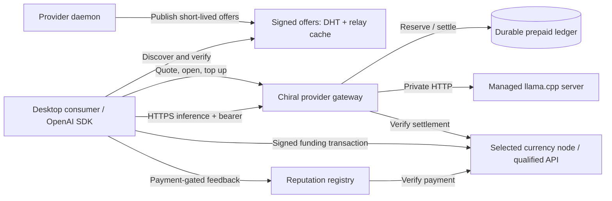

# LLM-serving migration plan

**Status, 2026-11-25:** Strata-first with a curated catalog supersedes the earlier llama.cpp-only decision. The [Strata runtime guide](strata-runtime.md) and OpenSpec `adopt-strata-curated-launch` record implementation and validation. The historical llama.cpp cutover and real Linux CPU/CUDA evidence below remain valid only for those exact deployments; they do not qualify Strata. Full-model Strata inference, hardware performance and supported-platform packaging remain release gates. Settlement, immutable agreements and the private-validation scope are unchanged.

**Currency decision:** Conflux eSpace native **CFX**, testnet chain **71**, genesis **`0x3fb9d350f95424c3c27fcf248d9a6f633a83c2a75c11ef887ea41540c85e7804`**. [Section 16](#16-expanded-currency-comparison-existing-pools-and-rtx-5090) preserves the research leading to selection. Implemented credit acceptance requires stable successful canonical execution at the healthy `safe` frontier. Pending, first execution, safe acceptance and PoS `finalized` remain distinct. A missing receipt alone is unavailable evidence, not a reorg.

## 1. Recommended direction

Build a marketplace for **complete, provider-operated model endpoints**, not a system that splits one model across unrelated Internet peers.

- **Selected launch engine: Strata**, pinned behind the Chiral Rust gateway with a small allowlisted catalog. Keep llama.cpp only as explicit legacy development/recovery support; no automatic fallback or reuse of legacy qualification. vLLM remains retired.
- **Protocol: a documented OpenAI-compatible subset**, not unrestricted engine passthrough. Certify exact tokenization, usage, cancellation and capabilities for every selected model/runtime.
- **Native providers: Windows, macOS and Linux.** Initially qualify Strata CUDA on NVIDIA systems and Metal on Apple Silicon; Vulkan is legacy-only. CPU execution is useful for development, not an automatic paid performance class.
- **Process boundary:** Chiral owns the native engine lifecycle. One installed product may contain a private child process; in-process FFI is not selected. Use a bounded adapter for the selected upstream protocol and preserve failure isolation.
- **Control and accounting: Chiral owns them.** Signed discovery, provider identity, quotes, chain verification, prepaid accounts, credentials, admission control, receipts, and reputation belong in this repository.
- **Launch settlement: Conflux eSpace testnet, native CFX.** The native `eth_*` chain contract replaces chiral-coin RPC/trust semantics while retaining integer-money and signed-transaction evidence. One backend is implemented. Existing miners/pools remain external, with explicit Core-to-eSpace transfer and no automatic mining/node startup on login.
- **Consumers and providers are cross-platform.** Public providers still require HTTPS and public reachability; choosing a desktop runtime does not add NAT traversal or authorize home-network tunneling.
- **First consumer milestone: developer API / SDK.** Prove funding, API credentials, streaming, billing, and receipts with standard clients before the large desktop UI build.
- **Eventual first release: public testnet beta. Current execution scope: private validation only.** Zoo-6's RTX 4060 is now explicitly dedicated to private inference testing, with its miner stopped. That approval does not authorize hardware rental, interruption of other miners or public provider admission. Preserve all public-release gates below. Mainnet mining economics are selection evidence, not testnet earnings; fast first inclusion does not prove safe settlement.

## 2. What exists, and what does not

The current runtime replaces the file-sharing application with a shared Rust inference core, headless provider/CLI/relay/RPC gateway, and native consumer UI. Implemented paths include network-scoped chain verification and signing journals; payer-authenticated quotes/funding intents/accounts; SQLite reservations, receipts and fee remittance; private-engine chat/completions/embeddings routes; signed DHT offers/catalog; payment-gated feedback; and explicit wallet/credential handling. A route or UI existing is not qualification of all its behavior.

The legacy file/Drive/ChiralDrop/CDN/site/mining runtime has been removed rather than hidden behind navigation. New state is separately namespaced; old files, chain databases, keys and history are not deleted or imported. Neither CHI nor historical CHR balances/reputation become CFX credit. Schema-3 provider ledgers refuse old schemas without conversion; preserve those ledgers and their obligations.

The initial inspection found a different application: Freshnet/legacy-chain defaults, unsigned storage ads, a public key-returning headless wallet route, fixed-gas empty-calldata sends, best-effort file fee legs, transfer-only reputation, and unconditional desktop dependencies. Those findings motivated the cutover; they are **historical**, not descriptions of the new runtime or a live deployment. The new code separates public inference from bearer-authenticated loopback administration and gates desktop dependencies behind the Cargo `desktop` feature. Security/public-deployment qualification is still required; removed vulnerable code is not a substitute for exercising the new boundaries.

The code and exercised slice are summarized in Section 14. Native settlement and performance admission/remediation are implemented; full selected-chain SDK/model/platform, multi-provider/failure/load and deployment qualification remain open. Evidence-only renewal is approved: preserve immutable agreements and balances while binding each request to a freshly qualified report for otherwise identical terms. Chiral-coin publication is no longer a launch dependency; its provenance limitations remain attached to historical results.

### Corrections required by the cutover

1. Remove storage and arbitrary container rental from the product and roadmap. Optional Linux provider containers are deployment machinery, not a container-rental feature.
2. The prototype's chiral-coin-specific identity, receipt and trusted-frontier contract has been replaced with Conflux eSpace testnet semantics. Ethereum-compatible encoding and implementation alone do not qualify the full native payment lifecycle.
3. Replace optimistic mempool credit with an explicit settlement policy. A seen transaction is not spendable prepaid credit.
4. Authenticate contract opening and credential recovery. A public transaction hash is evidence of payment, **not proof that the HTTP caller controls the payer**.
5. Reserve balance atomically before inference; checking balance without reserving allows concurrent overspending.
6. Specify cancellation, engine failure, missing usage, and restart recovery. The happy-path final `usage` object is insufficient for billing.
7. Separate fee arithmetic from fee collection. Subtracting a fee in a ledger does not transfer it to the platform.
8. Scope signed records, balances, receipts, RPC caches, and transaction deduplication to the chain identity and testnet generation, not just the wallet address.
9. Do not require a custom Chiral version header from ordinary OpenAI SDKs. Enforce Chiral control-protocol versions during onboarding and credential issuance; the public inference API must work with standard bearer auth.
10. Do not describe DHT provider lookup as an exhaustive marketplace database. It returns peer candidates and requires an explicit, bounded way to fetch their signed offers.

## 3. Selected engine: llama.cpp

The user selected **llama.cpp instead of vLLM**, prioritizing Windows/macOS/Linux provider participation, the GGUF ecosystem and direct integration into Chiral. This is an architectural decision, **not a measured assertion that llama.cpp is faster**. Earlier Linux-server-first plans selected vLLM for its serving stack; those runtime/deployment instructions are superseded.

### Runtime and packaging

- Pin upstream **v0.9.0**, source `cd959bae99ff4bed22bef2604f45241c09bbb8c8`, whose release points to binary build **b12110**. Verify the selected platform archive and inventory every installed executable/shared-library byte; no floating `latest`, automatic model downloads at launch, Python environment or Docker requirement for native execution.
- Use the same Rust-managed `llama-server` boundary on Windows, macOS and Linux. A separate process is an availability boundary, not an automatic security sandbox. Native driver/runtime compatibility and signed installers still need actual platform qualification.
- Bind managed engines to literal loopback with a protected API-key file. Do not pass secrets in command arguments, expose the engine UI/admin endpoints, inherit model-changing environment overrides or give the engine wallet credentials.
- Configure model, task, per-slot context, concurrency, device selection, layer offload, split settings, KV types, attention and batch sizes explicitly. Disable implicit memory fitting, context shifting and cross-request prompt-cache reuse for the qualified workload. A configured limit must not silently shrink to fit.
- Verify artifact/runtime inventories before launch. Loading, ready, draining, failed and stopped are distinct; an engine failure must remove admission/publication without automatic paid retries. Bound startup and shutdown and retain process ownership.

### Model identity and serving contract

- Provision operator-selected **GGUF** files from a pinned Hugging Face commit, including every shard. Model/tokenizer metadata live in that artifact; preserve the quantization identity, embedded template digest, license acknowledgement and exact inventory. No safetensors fallback, remote model Python, arbitrary uploads or implicit conversion.
- Generation and embeddings remain separate tasks. Derive baseline capabilities from the artifact, then require actual preparation/generation/usage probes before advertising them. Chat, completions, streaming, echo/logprobs, tools and structured output must not be assumed equivalent merely because an endpoint accepts an OpenAI-shaped request.
- Input reservations use the engine's exact tokenizer/template path; settlement uses validated authoritative usage. Output token IDs, not SSE event counts or re-tokenized text, establish performance timing. Unknown cancellation/failure usage remains zero-charge with the explicit unknown-usage outcome.
- Signed profiles replace vLLM image/memory-fraction fields with the native runtime inventory hash, platform/backend, physical device identities, dedicated versus unified memory, explicit headroom and all execution settings. Evidence is `chiral-performance-evidence-v2`; old reports are not converted.
- Nominal `8gb`/`16gb`/`32gb` tiers describe per-device physical capacity; `higher` can sum selected local devices. Unified memory is labeled explicitly, counted once and retains at least 4 GiB for the OS/other work. A 16 GB Mac is not a 16 GB dedicated GPU. Fit and measured headroom—not a nominal tier—determine usable context/concurrency.
- Preserve old agreements, balances, fees and evidence. Changed model/artifact/runtime/hardware terms need a distinct agreement; this cutover is not evidence-only renewal or automatic credit transfer.

### Qualification, not a speed assumption

Exercise real private-engine and paid-gateway paths on each selected platform with matched models, quantization, limits and workloads. Measure time to first token, output-token timing, sustained concurrent load, errors, memory/headroom, cancellation and crash recovery. Separate warm and cold behavior. The 20/50/100-token/sec policies, 95% joint attainment and inference-waiver accounting remain unchanged.

GPU/OS availability is not qualification: zoo-6's previous vLLM result cannot certify llama.cpp, and Linux results cannot certify Windows or Metal. Record only exercised evidence. A future engine comparison would need matched hardware/model/precision/workload and billing correctness before performance ranking; no alternate adapter is part of this cutover.

Primary references: [llama.cpp](https://github.com/ggml-org/llama.cpp), [pinned server API](https://github.com/ggml-org/llama.cpp/blob/cd959bae99ff4bed22bef2604f45241c09bbb8c8/tools/server/README.md), [GGUF on Hugging Face](https://huggingface.co/docs/hub/gguf), [Tauri external binaries](https://v2.tauri.app/develop/sidecar/).

## 4. Target architecture

**Boundaries:**

- The relay accelerates discovery and hosts reputation/version services. It does not carry inference prompts or become a custodial payment gateway.
- The provider gateway is the only public inference entry point. The model server, tokenization endpoints, engine metrics, and operational controls stay on loopback or a protected private network.
- Inference traffic is HTTPS/SSE, not the legacy chunked libp2p transfer protocol. Multi-GPU execution may happen inside one provider's trusted network; cross-provider tensor parallelism is not part of this migration.
- Blockchain confirmation happens at funding/top-up time, not per request or per token. Existing settled credit remains usable during a temporary chain outage; new credit is withheld when settlement cannot be verified.
- A selected provider receives the prompt in plaintext at its endpoint. TLS protects transport, not against the provider. Signed model metadata is not proof of model execution or confidential inference.

## 5. Historical chiral-coin integration workstream — deferred for launch

**Scope notice:** this section records the prototype's chain contract and qualification constraints. It does not prescribe the launch currency. Its currency-specific deliverables are deferred; the selected CFX eSpace cutover replaces them while retaining the accounting, authentication, replay and recovery invariants.

The prototype repository is [chiral-network/chiral-coin](https://github.com/chiral-network/chiral-coin), a separate Reth-based node project described as proof-of-work liveness with stake-weighted VRF finality. Its integration is not portable to the shortlisted currencies by changing a URL.

### Critical provenance and readiness distinction

Two different source states were available:

1. **Authenticated GitHub `main`:** commit [`953a20b67a8f968a7c6a8c0e13280d84565928a9`](https://github.com/chiral-network/chiral-coin/commit/953a20b67a8f968a7c6a8c0e13280d84565928a9). Its [README](https://github.com/chiral-network/chiral-coin/blob/953a20b67a8f968a7c6a8c0e13280d84565928a9/README.md) says the workspace exists and nothing is wired to Reth. Its [node entry point](https://github.com/chiral-network/chiral-coin/blob/953a20b67a8f968a7c6a8c0e13280d84565928a9/crates/chiral-node/src/main.rs) only prints `chiral-node: not yet assembled (spec §10.7, step 1)`. The published specification describes the intended chain; it is not evidence that those RPCs are operational.
2. **Newer local working tree:** `/home/users/shuai/apas_projects/chiral-coin`, on `apas/chiral-coin`, has substantial Continuous/V7 node, EVM, RPC, and qualification work absent from that GitHub tree. Its base refs point at the same commit, so **the working-tree implementation must not be attributed to that commit**. `docs/public-testnet-qualification.md:8-31,49-77,106-138` records remaining release-gate, candidate-specific soak, distributed-fault, packaging, and public-genesis work. An actual local-v7 candidate binary was subsequently exercised in isolation (Section 14); that is not evidence those public-chain qualifications passed.

**First chain release deliverable:** freeze and publish the actual implemented source and reproducible node artifact, complete candidate-specific qualification, and publish exact genesis/profile and RPC contract. Local integration has been demonstrated, but no public RPC, explorer, faucet, finalized public genesis, or reproducible published source for that candidate was established by the handoff. This blocks public rollout, not internal serving/accounting development.

### Concrete compatibility work against the local candidate

The following describes that **local candidate only**, not verified GitHub-main functionality or fixed public-testnet parameters:

| Candidate observation | Required application change |
|---|---|
| Chain ID **2600** (`0xa28`); documentation calls the asset **CHR**, with **10^18 wei per CHR** | Make symbol/decimals/chain identity explicit; replace CHI UI strings and assumptions. Do not treat the shared candidate chain ID as sufficient to distinguish local/test profiles |
| KawPoW with ASERT, 15-second target; London EVM execution | Remove Ethash/ethminer/Geth mining controls. Keep node/miner/participation operations in chiral-coin tooling |
| Legacy EIP-155, EIP-2930, and EIP-1559 transactions accepted; secp256k1/Ethereum-style addresses | Existing spending keys can be retained, subject to signing-vector and live-transfer qualification; no balance migration is implied |
| Nonzero gas fees; starting base fee 1,000 wei/gas and configured floor 1 wei in inspected profiles | Reserve network gas in addition to funding and marketplace fees; remove zero-gas claims |
| `eth_getBalance` / `eth_getTransactionCount` accept only `latest`; pool admits one current-nonce transaction per sender | Serialize submissions and persist the pending transaction journal. Merely replacing `pending` with `latest` leaves nonce races |
| RPC includes send-raw, balance, nonce, gas price, block number, and receipts; no `eth_getTransactionByHash`, block lookup, `eth_estimateGas`, `eth_call`, `eth_getCode`, `eth_getLogs`, or subscriptions | Build a narrow adapter; do not assume a generic Ethereum provider or existing wallet history scanner works unchanged |
| `chiral_chainIdentity` exposes chain ID/genesis; `chiral_nodeStatus` exposes head, accepted and trusted frontiers, and closed states | Add these specific read methods to the RPC proxy allowlist; do not allow all `chiral_*` methods, which include mutating/operator operations |
| RPC is loopback HTTP, batches limited to 8 and responses to 64 KiB | Deploy an explicit authenticated/TLS remote gateway, bound batch sizes, and handle size/capability errors |
| Receipt includes sender/recipient/status/block/logs, but not transaction value or calldata; displaced transactions return null | A successful receipt alone cannot establish funding amount or terms; implement the transaction-evidence path below |
| Moving PoW trust boundary can override certified history; candidate depths 128 for testnet and 8 for local are provisional | Define reorg exposure explicitly; never describe a certificate or those depth values as irreversible finality |

Candidate evidence paths relative to the local chain checkout: `integration/reth-spike/src/staking/native/indexed/continuous/operator.rs:28-44,92-105,216-251`; `operator/policy.rs:79-87,299-312` under that same Continuous directory; `node/rpc.rs:98-252,292-354`; `node/pool.rs:250-361`; `node/rpc/receipts.rs:76-180`; `state/evm.rs:180-246`; and `verified/src/moving_fork.rs:103-138`. The remote specification also names CHR/10^18 wei, but differs from later local consensus work; do not mix its older checkpoint rules with the candidate's moving-trust rules.

**Implemented transaction-evidence path:** the payer supplies the original signed transaction bytes during funding registration/open/top-up. The provider decodes the supported envelope, verifies canonical signature/chain binding, recomputes its hash, and checks sender, recipient, value, nonce, and committed terms locally. It then fetches the matching successful canonical receipt from its own chain node or an explicitly trusted RPC gateway. Signed bytes are not a private key, but can authorize broadcast; the exact acknowledged-intent order and residual disclosure risk are specified in the [book](chiral-book.md#agreements-and-exact-funding-order). A receipt from an arbitrary consumer-supplied RPC is not acceptable evidence. A bounded canonical transaction-lookup RPC is an alternative chain-side enhancement, not an already available method.

For an initial direct payment, use an ordinary provider receiving address and bounded commitment calldata. Calculate London intrinsic gas for that exact transaction when no estimation RPC exists; do not guess a contract-call gas limit. If a provider payee can be a contract, either add proper estimation/simulation/code inspection or introduce an explicit supported payment-contract flow first.

**Implemented candidate settlement policy:** require a successful currently canonical receipt at or below the node's reported trusted frontier, a healthy/non-closed node, and a repeat canonical receipt check before crediting. Record the policy/version with the account and disclose residual reorg risk. Continue monitoring credited funding; an orphaned payment freezes further spending, reverses unspent credit, and records any already-consumed shortfall separately rather than producing a negative available balance. Apply the same policy to reputation. Normal funding has real-chain evidence; displacement/stall/failure coverage remains a qualification requirement. These are application risk rules, not a new consensus guarantee.

### Network profile and RPC boundary

The implemented explicit network profile is consumed by wallet, daemon, relay, and frontend; public publication still must supply:

- Chain ID, genesis hash, deployment/reset identifier, display name, native asset symbol and decimals.
- RPC endpoints, explorer link if deployed, funding/faucet instructions, supported transaction types, gas/fee policy, and settlement policy.
- Pinned chain release/commit and configuration version.

Check chain ID and genesis identity on connection, using the selected node's supported identity method (`chiral_chainIdentity` in the local candidate), not an assumed `eth_getBlockByNumber`. Refuse an endpoint on the wrong network; never fall back silently to the old `.73:8545` chain. Namespace balances, transaction history, nonces, reputation, contracts, signed payloads, and deduplication by network. A reset that reuses a chain ID still needs a new deployment namespace and a reset policy; clearing a browser cache is not sufficient.

Keep the pooled RPC transport, but separate it from Core-Geth process management. Retain read failover only among identity-checked endpoints for the same chain. A write uses a single selected endpoint and tracks the signed transaction hash; a timeout is not evidence that broadcasting failed.

### Wallet and payment verification

- Prove key/address/signature compatibility with chiral-coin vectors before reusing wallet serialization unchanged. Key compatibility does not transfer old balances or reputation.
- Represent amounts in exact base units throughout Rust and TypeScript; decimal strings on JSON boundaries. UI formatting must not round-trip payments through JavaScript `number` or Rust `f64`.
- Support value-bearing transactions with agreement commitments in calldata. Calculate exact intrinsic gas for the restricted direct-payment profile, or use a qualified estimation path when available; a fixed 21,000-gas transfer is not a valid general assumption. Recover wallet history from durable submitted transactions and verified receipts until a bounded canonical history/indexer API exists; disclose that limitation rather than return a fabricated complete history.
- Verify sender, recipient, value, transaction type/chain binding, successful execution, exact terms commitment, canonical block identity, and the configured settlement condition before crediting.
- Store transaction hash and credited account under a database uniqueness constraint. Opening and top-up replay must return the existing result without crediting twice.
- Model funding as pending, policy-accepted, rejected, or orphaned. Handle acceptance/finality stalls explicitly; never relabel a mined receipt as irreversible merely because a timeout passed.
- Retire Core-Geth installers, generated genesis, old bootstrap addresses, Ethash/ethminer launchers, and old `miner_*` UI assumptions. Chain-node and validator/miner administration should follow chiral-coin's own tooling.
- Consumer onboarding should use a separately operated testnet faucet or explicit funding instructions. Do not embed faucet authority or validator keys in the app.

### State migration

The cutover uses a separate full-network-identity namespace and preserves existing data without automatic import or deletion. Legacy wallet keys may be explicitly exported/imported through protected files; preserve old history and Drive/chain data separately. Old CHI balances are not spendable CHR, and file-transfer reputation is not imported. There is no token bridge, redenomination, or automatic migration. A real multi-provider cutover/data-preservation exercise remains part of the release matrix.

## 6. Repository change map

The original refactor/removal work is now reflected in these cohesive runtime modules. This table is a source map, not a test result:

| Area | Current location | Contract |
|---|---|---|
| App and native consumer | `src/App.svelte`, `src/pages/`, `src/lib/`, `src-tauri/src/desktop.rs`, `consumer.rs` | Marketplace, playground, provider status, usage/API credentials, wallet, network, settings and diagnostics; native streaming/cancel; no browser wallet simulation |
| Network, wallet and chain | `network.rs`, `wallet.rs`, `chain_client.rs`, `rpc_client.rs`, `chain_rpc_api.rs` | Explicit chain/genesis/deployment identity; protected keys; exact signed-transaction evidence; shared signing-wallet nonce journal; bounded RPC |
| Discovery | `dht.rs`, `offer_registry.rs`, `protocol.rs` | Signed model/deployment offers, bounded Kademlia candidate/manifest retrieval, verified relay catalog |
| Provider lifecycle | `provider_config.rs`, `app.rs` | Explicit private engines and limits, health-gated publication, separate public and local-admin routers |
| Control and accounting | `auth.rs`, `contracts.rs`, `billing_store.rs` | Payer-bound one-use challenges, immutable quotes, durable acknowledged funding intents, credentials, atomic reservations, signed receipts and fee journal |
| Inference | `inference_gateway.rs`, `inference_backend.rs` | Allowlisted API subset, exact preparation, real engine/SSE usage, cancellation and unknown-usage recovery |
| Reputation | `rating_api.rs`, `rating_storage.rs`, `reputation.rs` | Network-scoped verified payment admission, payer-signed feedback and Elo |
| Entry points | `lib.rs`, `bin/chiral.rs`, `bin/chiral_daemon.rs`, `bin/relay_server.rs`, `bin/chiral_rpc_gateway.rs` | Shared services; headless builds use `--no-default-features`, no required GUI dependencies |
| Deployment | `Dockerfile`, `docker-compose.yml`, `scripts/`, `dev/provider/`, `.github/workflows/test.yml` | Explicit pinned inputs, private engine and local-admin boundaries, provider/consumer inference workloads |

The new runtime excludes Drive/seeding/shares, file/folder search and sales, ChiralDrop, upload/download orchestration, CDN pricing/expiration, static-site publication/directory, hosting agreements, file speed tiers, bespoke file transports, old miner installers/launchers, and their commands/events/startup recovery. Legacy source references from the original plan describe removal targets, not files to revive. Continue checking the final release artifact, permissions, tests, deployment flags and documentation for obsolete surfaces; hiding navigation is never sufficient.

No compatibility aliases, old chain-write fallback, or automatic user-data conversion are part of this cutover. The final public-release gate still requires an explicit artifact-level cutover and data-preservation exercise.

## 7. Discovery and provider identity

Publish one signed record per provider deployment/model offer, not one mutable record for every model owned by a wallet. Multiple machines owned by one provider need distinct deployment IDs.

A signed inference offer should bind:

- Protocol version and full network identity.
- Provider wallet, peer ID, deployment ID, monotonically increasing revision, issue/expiry times.
- Public HTTPS origin, model API ID, immutable model revision or artifact digest, tokenizer/chat-template revision, quantization, and effective context/output limits.
- Supported endpoints and capabilities: streaming, tools, structured output, embeddings where offered, reasoning-token usage semantics.
- Exact input/output prices per explicitly named unit, minimum funding, fee terms, and cancellation/failure charging policy.
- Region and operator-declared capacity, clearly separated from independently observed availability/latency.

Use an owner-derived key plus a content hash of the canonical payload. A malicious first writer must not acquire another wallet's namespace. Reject unsigned, wrong-owner, expired, rollback-revision, and wrong-network records. An old signed offer is authentic but not necessarily current; a signed quote pins the version the provider will honor.

For browsing, use per-network/per-model Kademlia provider indexes to obtain candidate peer IDs and a bounded control request to fetch each peer's signed manifest. Keep a relay-side verified catalog with pagination/search for convenient browsing. Re-verify returned offers in the consumer. A relay can omit offers even when it cannot forge them; disclose that distinction and preserve a direct-discovery path.

The legacy implementation returned first-hit file records and relied on a CDN fallback. The replacement inference discovery merges verified candidates within bounded searches instead. Invalid-first replicas, stale records, relay outage, malicious URLs and multi-deployment behavior remain mandatory qualification cases; do not infer them all from one successful local discovery run.

Withdraw or stop refreshing offers when the corresponding model is unhealthy. Discovery health checks must not trust arbitrary endpoints: constrain schemes, ports, redirects, resolved IP ranges, and response sizes to prevent SSRF and DNS-rebinding access to internal services. Permit local test endpoints only under an explicit development profile.

## 8. Agreements, credentials, and prepaid accounting

### Control API

The implemented `/v1/contracts` control surface is narrowed to inference. Its exact route inventory and funding-intent ordering are documented in the [current book](chiral-book.md#agreements-and-exact-funding-order); the original operation-level requirements remain:

| Operation | Purpose |
|---|---|
| Propose | Obtain a provider-signed quote binding consumer, offer, model, prices, limits, fee policy, nonce, network, and expiry |
| Open | Verify funding and a consumer proof; create/recover the prepaid account and issue its credential |
| Top up | Verify a new payment committed to the same account; credit once |
| Read balance / usage | Return settled funding, fees, spent, reserved, available, and request status |
| Read receipt | Return a provider-signed attributable usage statement |
| Rotate / revoke credential | Manage a scoped bearer using owner authentication |

Authenticate open, recovery, top-up ownership, and credential rotation using a one-use server challenge signed by the consumer. Bind the signature to the chain/deployment, provider, method, path, canonical body hash, nonce, and expiry. The existing timestamp/method/path owner-proof pattern is useful but does not by itself bind a mutable JSON body or make a request single-use.

Issue random high-entropy bearer tokens and store only their hashes server-side. Scope each credential to an account, permitted models, expiry, concurrency, and spending limits. Never send wallet private keys to a provider. Store consumer credentials in protected application storage and redact them from logs. Support explicit issuance of separate application credentials rather than reusing the desktop session everywhere.

A zero-price offer should still authenticate and rate-limit callers, but must not require a fake on-chain transfer. Give free sessions a separate unambiguous identifier and no payment-gated reputation eligibility.

### Ledger, not JSON counters

Use a transactional durable database for a single-provider gateway with consistent backups. Current performance ledgers require **schema 3** and refuse older schemas without conversion; preserve old agreements, accepted funding and journals rather than deleting them to start fresh. SQLite supports one gateway process, not a shared multi-host file; scale-out requires a separately designed transactional database/locking strategy.

Persist agreements/quotes, funding transactions, credentials, inference requests, reservations, usage debits, fee obligations, and receipt sequence numbers. Store base-unit values in a representation that preserves their full width; SQLite's signed 64-bit `INTEGER` is not automatically sufficient for wei. Use checked integer arithmetic in the billing layer and uniqueness constraints for replay prevention.

For prices expressed in base units per 1,000 tokens:

`actual_cost = ceil((input_tokens * input_rate + output_tokens * output_rate) / 1000)`

Specify one rounding rule, use checked wide intermediates, and bill once per request, not once per SSE fragment. Define cached-input and reasoning-token treatment in the quoted terms. For the initial profile, use one input rate for all prompt tokens and include generated reasoning/tool tokens in the output count; do not charge rejected speculative draft tokens. Do not silently change those semantics when upgrading an engine.

Before execution:

1. Validate supported parameters and model readiness.
2. Determine the actual prompt token count with the same tokenizer, template, tools, and options used by the engine. Never use character count or a generic OpenAI tokenizer for an arbitrary model.
3. Require or apply an explicit bounded output limit. Initially constrain `n` to one and reject `best_of`/beam-expansion options rather than under-reserving unbounded generations.
4. Calculate the maximum cost using separate input/output prices.
5. Atomically reserve that amount against available credit; reject insufficient funds before dispatch.
6. Dispatch only after the durable reservation succeeds.

At settlement, atomically record actual usage, charge at the quoted rate, and release the unused hold. In the normal case, `funded = fees + spent + reserved + available`. With chain reversals, use explicit journal entries: `net_credit = accepted_funding - net_fee_charges - funding_reversals + provider_loss_credits`, and `net_credit = spent + reserved + available`. A provider-loss credit records an already-consumed orphaned payment; it must not create new spendable credit. Further invariants: no negative available balance; each funding payment credits once; each request debits at most once. Releasing unused authorization is not refunding an on-chain prepaid deposit.

### Failures and streaming

- SSE chunks are not tokens. Obtain usage from the certified engine's per-request usage mechanism, including the final usage chunk even when the external caller did not request it.
- Keep standard streaming fields intact. Expose authoritative billing through the request/receipt API and optional Chiral extensions; final costs cannot be retroactively inserted into initial HTTP headers.
- On client cancellation/disconnection, propagate cancellation upstream and reconcile the actual engine usage. The quoted cancellation policy must state which generated work is billable.
- Recommended initial failure policy: charge only reliably attributable usage; if the engine/gateway failure leaves usage unknowable, release the unsettled hold and record a provider-side loss, rather than charging the entire reservation or estimating from text. Rate-limit abuse of this policy.
- Persist a request state machine and durable usage checkpoints where supported. Restart recovery must resolve orphaned reservations deterministically, never leave funds locked indefinitely or charge a request twice.
- Do not transparently replay paid generation after an ambiguous timeout or after any output has streamed. A repeated request identifier must not start a second generation silently; return its known status. Standard SDKs may retry without preserving a custom key, so document retry behavior and recommend disabling automatic retries for paid generation where ambiguity cannot be resolved.

### Platform fee

**Selected and implemented mechanism: provider-remitted fees at 0.5% (50 basis points).** State the rate in the signed quote. Pay the provider, credit funding less `floor(funding_wei * 50 / 10000)`, and create a durable fee-remittance obligation with tracked on-chain payment and restart-safe shared signing-wallet nonce handling. Network gas is a separate expense, including the provider's remittance gas. Automatic aggregation uses `10^15` wei or an oldest-obligation age of 86,400 seconds; an operator can explicitly request remittance. The historical book's adjustable 0.1% floor is not part of this release. A real isolated fee transfer is evidenced in Section 14; failure/recovery and public-operation qualification are separate gates.

This is **not trustless fee collection**. A dishonest provider can withhold remittance. Do not claim a platform fee imposes a real wash-rating cost unless its transfer is independently verified. Atomic splitting and refundable escrow are not part of the selected launch payment mechanism. A future atomic split would require a separately reviewed/deployed contract and event-based funding verification; it is not achieved by calling `split_payment`.

## 9. Inference gateway and provider operations

### Public compatibility target

Launch support should explicitly cover `GET /v1/models`, `POST /v1/chat/completions` with non-streaming and SSE, `POST /v1/completions`, and `POST /v1/embeddings` when an embedding deployment is configured. A chat model is not automatically an embedding model. Advertise tools/JSON-schema support only for qualified model/engine combinations; tool-call generation does not authorize executing tools on the provider host.

Keep errors OpenAI-shaped. Define authentication failures, unsupported parameters, unknown models, insufficient balance, queue saturation, context overflow, engine unavailability, and cancelled/failed stream behavior. Cap request bytes, prompt/output tokens, embedding batch size, queue length, concurrency, and execution time. Use long-lived streaming timeouts and bounded backpressure; do not reuse the RPC client's five-second total timeout for generation or buffer an entire streamed response.

Responses API, images/audio/video, fine-tuning, batch jobs, arbitrary model uploads/LoRA loading, agent/tool execution, and cross-provider sharding are outside this proposed first release. They require explicit protocol and billing extensions, not blind passthrough of every engine endpoint.

### Provider setup

- Provision a pinned native llama.cpp runtime and GGUF artifact; the Rust provider manages the child process. Native Windows/macOS/Linux operation does not require containers. Linux Compose remains an optional operator deployment.
- Pin the runtime inventory digest, model/GGUF revision, template, quantization, device/driver compatibility and execution limits. Require the operator to accept model licenses and supply gated-model credentials privately during provisioning.
- Gate publication on readiness plus a real inference probe, not an open TCP port. Distinguish loading, ready, draining, unhealthy, and stopped states.
- Drain before model/version/pricing changes; existing agreements retain their terms. A revision change must not silently replace the model promised to active consumers.
- Separate gateway wallet credentials from the engine. Avoid privileged containers and host-wide filesystem mounts. The current provisioning/qualification path forbids arbitrary remote model code; operator preference does not silently make `trust_remote_code` a supported profile.
- Default to no prompt/completion logging. Record request IDs, counts, prices, timing, errors, and ledger transitions; document any optional content retention.

The engine is not the public paid-service boundary. Expose only Chiral's allowlisted gateway routes. Keep engine, metrics and administration listeners private, including public-by-design health endpoints; API-key support alone is not complete isolation. No prompt or model-management route belongs on the relay.

## 10. Consumer UI, daemon, CLI, and reputation

### Desktop

Replace `/download`, `/drive`, `/chiraldrop`, and `/hosts` with:

- **Marketplace:** model/provider offers, capabilities, input/output pricing, context limits, observed availability, provider reputation, and explicit testnet identity.
- **Playground:** select an offer, inspect terms, fund, stream chat, cancel, see actual usage and cost, and distinguish insufficient balance from engine/chain failures.
- **Usage and API access:** per-provider balances, reservations, receipts, funding history, credential creation/revocation, and working Python/JavaScript SDK examples.
- **Provider dashboard:** engine readiness, model inventory, prices, public endpoint checks, publication state, active requests, balances/earnings, and fee obligations.

Retain wallet/account, network, settings, and diagnostics with updated semantics. Replace mining-oriented onboarding with funding instructions. Remove old download directory, seeding, CDN, file notification, and mining controls. Show that funds are provider-specific and non-refundable; switching providers does not move prepaid balances automatically. Never reroute a prompt to another provider without consent to the new privacy and payment boundary.

The implemented desktop uses a Rust streaming client and Tauri channel/cancellation bridge. Wallet keys and long-lived credentials stay behind the native boundary; raw private keys are no longer Svelte state. Continue qualifying untrusted-output rendering, remote navigation/media, CSP/Tauri capabilities and secret isolation before public distribution. Conversation persistence must remain local, opt-in, wallet/network-isolated and removable if introduced; never publish conversations to the DHT. Browser preview alone is not proof that Tauri streaming/cancellation work. Native Linux evidence is recorded in Section 14; it does not qualify Windows/macOS.

### Headless and CLI

Provide commands for provider configuration/readiness, offer publish/withdraw/list, account funding/status, usage/receipt retrieval, credential management, and a streamed inference invocation. Keep local operator APIs bound to loopback and authenticated separately from public consumer APIs. Reuse shared Rust application services instead of cloning business logic into CLI handlers.

### Reputation

Retain the Elo calculation only after changing event admission and storage. Feedback must be signed by the actual payer, reference a verified funding relationship, and bind provider/network. Derive amount and payer from verified chain evidence, not caller-supplied fields; reject unpaid/free-session feedback and direct self-ratings. One rating per defined payment/agreement identity, with deterministic replacement when revised; repeated updates must not accumulate fresh votes. Keep objective availability/latency/error data separate from subjective response quality. Explicitly replace the current transfer-verdict/issuer-key admission path and update daemon/relay wiring together rather than leaving two incompatible rating protocols.

A signed offer or receipt proves attribution, not model identity or fair metering. Cheap faucet currency also weakens any economic Sybil-resistance claim. Mark testnet reputation as experimental and reset/network-scope it rather than importing file-transfer scores.

## 11. Verification and deployment gates

### Behavior that must be exercised

- Real selected-currency funding with native invoice/agreement commitment; exact balances and fees; rejection of wrong-network, failed, orphaned/unsettled, unauthorized-payer, wrong-recipient, malformed-commitment and replayed payments. Qualify native input/output or box semantics, not just the historical EVM path.
- Real llama.cpp generation through the gateway with an unmodified OpenAI SDK: chat, SSE, completions, and a separately configured GGUF embedding model. Verify exact usage and ledger amounts, not just HTTP success.
- Simultaneous requests against one nearly empty balance; reservation/settlement invariants under concurrency and restart.
- Client cancel, network disconnect, engine kill/OOM, malformed upstream events, missing final usage, gateway kill after dispatch, and repeated open/top-up submissions.
- Credential theft boundaries: another wallet cannot claim a public funding hash; expired/revoked credentials stop working; model/admin endpoints cannot bypass billing.
- Signed discovery under stale/forged/wrong-network offers, provider disappearance, relay outage, multiple deployments per wallet, and malicious endpoint URLs.
- Actual Tauri streaming UI on supported consumer platforms, plus headless CLI behavior. Inspect cancellation, pending funding, insufficient funds, and provider failure states.
- A multi-provider testnet exercise: discover, fund, infer, reconcile, restart, top up, rate, withdraw an offer, and confirm that existing data is preserved at cutover.

Use deterministic unit tests for signatures, integer arithmetic, reservation boundaries, replay, state transitions, and feedback updates. Keep integration tests for actual chain and engine behavior. Do not count mocked usage responses or a 30-node file-transfer script as proof of paid inference.

Wallet/auth/RPC/network/version/reputation tests now target the inference contract; legacy file-feature tests were removed with their behavior. `.github/workflows/test.yml` defines headless `--no-default-features --all-targets` tests and explicit opt-in real-GPU qualification on an isolated pre-provisioned runner; defining the job is not evidence of a successful run. `scripts/` and `tests/scaled/` target provider/consumer roles, not miner/seeder/file-transfer roles. Mocked workloads and a formerly opt-in live relay test must never be relabeled as real-chain/inference qualification.

### Deployment topology

Separate chain nodes/faucet, DHT bootstrap/relay/reputation, and GPU providers. Existing CPU-only cluster capacity may validate discovery/control-plane scale, but cannot prove GPU serving capacity. Add a GPU-qualified runner or dedicated provider for engine integration and load measurements.

Replace legacy Docker/Compose manifests, scripts, service flags, volumes, readiness probes, exposed ports, and release artifacts. Pin chain and engine versions. Back up the new billing database and wallet material; practice recovery without replaying a payment or losing reservations. Document a coordinated protocol cutover for daemon, relay, and desktop, while keeping operational rollback separate from chain or database rollback.

Supply reproducible provider and chain-node service manifests rather than depending on manually configured legacy hosts. Remove privileged/unconfined container defaults. Pass the nonzero version-policy public key required by `src-tauri/build.rs` into release builds, and network-scope the policy endpoint instead of leaving it hard-coded to the old relay. Model health, ledger writability, and settlement readiness must have separate diagnostics; DHT existence alone is not provider readiness.

### Public launch gate — testnet remains the prior approval

Do not treat a successful private demonstration as release completion. Before public access:

1. Select and pin a supported, patched reference-node release and reproducible source/artifact for the chosen currency; qualify the native payment integration, security advisories, settlement policy, restart/reorg behavior and operational dependencies. Chiral-coin publication is deferred, not a launch dependency.
2. Publish the exact asset/genesis/network/deployment identity, discovery bootstraps, qualified node/API capabilities, authenticated transport and upgrade policy. Use the selected currency's existing network, not an invented genesis. Restrict node methods and independently bound submission/read traffic.
3. For testnet, provide legitimate test-fund access and label currency/reputation experimental. A mainnet beta requires explicit user approval, real-money/non-refundable disclosures and practical native-coin funding instructions instead; never label real payments test funds. No faucet, pool-payout or node authority keys belong in consumer builds.
4. Operate publicly reachable, TLS-protected Linux GPU reference providers. Pass operator-key isolation, admission limits, engine-port isolation, credential revocation, and request/ledger failure tests before accepting public clients.
5. Ship reproducible provider setup and SDK onboarding, verified fee-remittance accounting, monitoring, backups, and an incident procedure to stop new funding/admission without losing accepted balances or exposing secrets.

These are dependencies of the first public release, not reasons to postpone internal engine, gateway, or accounting development.

## 12. Implementation sequence and acceptance criteria

| Phase | Deliverable | Exit criterion |
|---|---|---|
| **0 — Freeze the contract** | Selected currency/network and supported node release; native payment/authentication contract; engine benchmark; detailed billing/failure/performance policy | Confirmed product decisions are reflected in wire/API contracts; network identity and settlement rule are concrete; selected engine satisfies accounting, cancellation and advertised performance requirements |
| **1 — Chain and isolated serving proofs** | Selected native chain client/wallet path; shared headless core; separate public/operator listeners; real engine behind gateway | A native transfer with signed-byte evidence and invoice commitment is verified; a real model streams; no legacy-chain fallback or public signing-key/control route |
| **2 — First paid API vertical slice** | Signed quote, payer-authenticated open, prepaid ledger, API credential, reservation, generation, usage settlement, receipt | A standard OpenAI SDK consumer funds one provider and receives a streamed completion; exact ledger reconciliation survives duplicate funding, disconnect, and restart |
| **3 — Discovery and provider lifecycle** | Signed offers, model/deployment catalog, DHT manifest retrieval, relay cache, health-gated publication, CLI | A second independent consumer discovers and pays a provider without a hard-coded provider URL; invalid/offline offers are excluded |
| **4 — Full supported product surface** | Marketplace, playground, provider dashboard, usage/API credentials, top-ups, completions/embeddings, feedback | Desktop and stock SDK/CLI flows work end-to-end for all advertised capabilities, with honest errors and non-refundable balance disclosure |
| **5 — Public cutover and qualification** | Legacy runtime/API removal; updated docs, packaging, CI, selected-chain/provider deployment, funding access, preservation procedure and load/failure exercises | Every public gate above passes on the approved network; no old file/mining feature is reachable or auto-started; no old chain writes; full advertised SDK/desktop behavior works and legacy user data is preserved |

Phase 1's chain integration and engine qualification can proceed independently once the network/protocol interfaces are fixed. Discovery can be built against the frozen signed-offer format while accounting is implemented. Phase 2 is the critical integration gate; a marketplace page listing models is not an end-to-end milestone.

Remove obsolete callers alongside each subsystem replacement, then prove the final release has no remaining legacy runtime surface. Do not leave compatibility aliases or disabled old modules indefinitely. Replace the old book/README/API/deployment documentation with the LLM-only contract as implementation lands; preserve historical material as history, not competing normative instructions.

## 13. Confirmed launch decisions and engineering defaults

The following launch decisions incorporate the user's latest approvals and revised currency-selection criteria:

| Decision | Confirmed choice | Implementation consequence |
|---|---|---|
| Provider platforms | **Native Windows, macOS and Linux**, superseding the earlier Linux-only scope | Private validation remains current scope. Each admitted OS/backend/model and installer requires qualification; Linux evidence does not qualify other platforms or authorize simultaneous public launch. Public HTTPS/reachability remains mandatory; home NAT traversal is outside scope |
| First consumer workflow | **Developer API / SDK** | Standard-client funding, credentials, inference, streaming, and receipts drive the first end-to-end milestone; desktop flows remain in the planned release |
| Payment model | **Small non-refundable prepayments** | Provider-specific balances; no launch escrow/refund/withdrawal protocol; explicit risk disclosure and incremental top-ups |
| Platform fee | **Provider-remitted fee** | Track obligations and actual remittance; use the proposed 0.5% default; do not claim collection is trustless |
| First deployment release | **Public testnet beta eventually; private validation only for now** | Public rollout remains deferred; private GPU work on zoo-6 is now authorized. Retain release gates; no hardware rental, public admission or uncertified speed claims |
| Launch currency | **Conflux eSpace (CFX), selected after expanded comparison; chiral-coin deferred** | Native eSpace testnet integration; verify exact network/genesis and successful canonical receipts at `safe`, track finality separately, document mining Core-to-eSpace transfer |
| Deployment transition | **Replace the legacy deployment** | Inventory, protected backup, isolated staging and coordinated cutover; preserve legacy data and money-state recovery |
| Model choice and capacity | **Provider-selected HF models; 8 GB, 16 GB, 32 GB and higher-end tiers** | Pin/validate artifacts and qualify model/hardware/context/concurrency independently of speed class; the new 8 GB tier requires at least 7,500 MiB per device |
| Performance commitment | **Qualified 20/50/100 tokens/sec classes with missed-request inference-charge waivers** | Declared workload, admission, evidence and zero-charge settlement implemented; preserve usage and non-refundable funding/platform/gas charges. Evidence-only renewal is approved; actual GPU qualification remains open |
| Mining operations | **Existing pools/miners are acceptable** | No self-operated pool launch requirement. Verify selected miner/Blackwell compatibility and payout conditions; keep mining off inference-reserved GPUs |

Engineering defaults retained by this plan:

| Area | Default | Qualification still required |
|---|---|---|
| Serving engine | llama.cpp only, private Rust-managed native server | Independently qualify each OS/backend/model/hardware profile; no speed claim from portability |
| Settlement | Successful canonical receipt at healthy eSpace `safe`, rechecked before credit; no mempool credit | Native sender/value/calldata binding, nonce/replacement coordination, duplicate-credit prevention, reorg/loss and acceptance-stall behavior; observe PoS finality separately |
| Model/API scope | Text chat/completions; embeddings and tool/structured output where qualified | Certify each advertised model capability; do not silently expose the entire engine API |
| Chain operations | RPC clients in the app; separately operated chain software | Publish limited RPC access and reproducible operator procedures |
| Chain artifact | Supported patched upstream release for the selected currency | Pin source/binary provenance and qualify actual APIs; archived pool software and untested payout paths are not production readiness |

**Historical first implementation target was exercised in isolation:** a Linux GPU provider funded on the chiral-coin candidate and accessed through stock SDKs with metered streaming and durable accounting. That does not qualify the current native CFX/performance stack. Section 14 keeps old and current evidence distinct. The user's latest private-validation decision defers—not satisfies—the public-release gates.

## 14. Execution evidence and open release checklist

### llama.cpp-only native cutover (2026-11-11)

- Removed the active vLLM adapter, Python-tokenizer/safetensors provisioning path and standalone engine container. Rust validates pinned native/GGUF inventories, launches private `llama-server`, observes actual devices, guards admission on child failure and owns shutdown. Windows/macOS/Linux provisioning and CI paths are present; only Linux CPU/CUDA execution was exercised here. In-process FFI is not selected.
- Exercised upstream **v0.9.0**, source `cd959bae99ff4bed22bef2604f45241c09bbb8c8`, official binary build **b12110**. Generation used `Qwen/Qwen2.5-0.5B-Instruct-GGUF`, revision `9217f5db79a29953eb74d5343926648285ec7e67`, Q4_K_M, context 4,096 and two slots. Separate embeddings used `nomic-ai/nomic-embed-text-v1.5-GGUF`, revision `0188c9bf409793f810680a5a431e7b899c46104c`, Q8_0, context 512 and native 768 dimensions.
- Real provisioning exposed safe upstream library aliases and Jinja source normalization; the installer now resolves only bounded in-package native-library aliases into regular files, and template identity matches the pinned lexer's effective source without changing the raw artifact inventory. The CUDA archive lacks runtime/cuBLAS redistributables; the private package includes verified NVIDIA native libraries and license/provenance files. See the [native runbook](chiral-book.md#native-provider-provisioning-and-operations).
- Latest verification: **205 Rust tests passed, 2 ignored, across seven suites**, and headless binaries built. **45 Python tests passed**. Frontend: **0 errors / 0 warnings**, **15 tests passed**, Vite build passed. These checks are not hardware certification.
- Stock **Python OpenAI 3.41.0** and **Node 7.45.1** exercised paid generation. Actual chat/completion, streaming/non-streaming, echo and generated-token logprobs worked; internal token IDs/timings stayed private. The approved echo behavior preserves prompt text but leaves input-token probabilities unknown. Node exercised both explicit-float and SDK-default base64 embeddings: two 768-component vectors per batch, exact 18-input-token usage and zero output tokens.
- A real full-context request initially failed at zero charge because llama.cpp sets `truncated` at an ordinary context-limit stop. The regression-backed correction accepts only a valid terminal stop with consistent exact usage at the contracted limit. **Both CPU and RTX 4060** then completed **3,840 input + 256 output = 4,096 tokens**, charging `4352000000000000` wei each. **3,841 + 256** was rejected with HTTP 400, without additional debit.
- Explicit cancellation and disconnect after output settled `cancelled_unknown_usage` and `disconnected_unknown_usage`, both at zero charge. Killing the managed CPU child after output settled `failed_unknown_usage`, zero charge, withdrew admission and yielded HTTP 503 for another request. Same-ledger restart preserved every existing account's financial fields and credential, then served another real paid request. No paid generation was automatically replayed.
- Completed-request replay returned 409. Public tokenizer/properties/metrics/admin paths returned 404; private properties without the engine token returned 401. Unsupported engine options returned 400. Final inspection found no pending consumer funding operation and no reserved balance.
- The new agreements contain **13 local CPU request records and 3 GPU request records**, including failed/interrupted records. Every completed request reconciled exact authoritative usage; unknown-usage records charged zero. Final balances, in CFX:

  | Agreement | Funded | Funding fee | Inference spent | Available | Reserved |
  |---|---:|---:|---:|---:|---:|
  | CPU generation | 0.020000 | 0.000100 | 0.005054 | 0.014846 | 0 |
  | CPU embeddings | 0.010000 | 0.000050 | 0.000036 | 0.009914 | 0 |
  | GPU generation | 0.010000 | 0.000050 | 0.004498 | 0.005452 | 0 |

- Zoo-6's persistent `chiral-llm-8gb.service` now runs the native gateway and managed llama.cpp child, using a new distinct provider wallet and protected journal. The old vLLM service is stopped; historical artifacts, agreements, keys and chain data were not rewritten. Driver **550.163.01** and the miner-stopped decision are unchanged. GPU inspection showed only the new llama-server compute process.
- The real serving-profile component was visually exercised in Chromium, including expanded runtime provenance and the **16 GiB shared-memory / 4 GiB reserve** display. Its explicitly synthetic layout fixture is **not** a Mac hardware run or qualification report.
- Evidence: `/var/tmp/chiral-llama-cutover-20261104/llama-cutover-evidence.json`, `paid-generation-evidence.json`, `paid-embedding-evidence.json`, `paid-gpu-evidence.json`, `interruption-evidence.json`, and `serving-profile-layout.png`. This protected workspace also contains credentials and must not be published wholesale.
- **Limits:** every smoke model remains `serving:null`. No speed class, comparative engine benchmark, Windows/macOS runtime/installer, Vulkan memory qualification, full new-stack native desktop flow, public TLS deployment or full failure/load matrix is certified. Hidden end-of-generation tokens can leave the exact decode clock unavailable even when billing usage is valid. Preserve the release checklist below.

### Historical vLLM 8 GB support and private zoo-6 GPU smoke (2026-10-30)

- Added `8gb` to Rust profile validation and Python runtime inspection. Boundary regressions admit 7,500 MiB, reject 7,499 MiB and prevent aggregating two 4 GB cards into this per-device tier. The existing generic frontend capacity label needs no new enum or special-case rendering.
- Verification: **187 Rust tests passed, 1 ignored, across 7 suites**; all **3 Python qualifier tests** passed; headless binaries rebuilt. Tests are not hardware performance evidence.
- The user chose **dedicate zoo-6 to private inference**, rather than a temporary mining pause. Its RTX 4060 reports **8,188 MiB**, driver **550.163.01**; the existing VM has 4 GB system RAM. The miner was stopped, unrelated resource monitoring remained active, and no chain node/data or hypervisor/driver configuration was changed.
- Provisioned and verified `Qwen/Qwen2.5-0.5B-Instruct`, revision `7ae557604adf67be50417f59c2c2f167def9a775`, for **float16 / context 4096 / maximum output 256 / concurrency 2**. Actual vLLM **0.11.0**, Torch **2.8.0**, no CPU offload, prefix caching disabled, GPU-memory budget 80%. Observed GPU allocation was 6,516 MiB after loading and 6,620 MiB after the smoke, including KV cache; these are snapshots, not a sampled peak.
- The stock Python OpenAI **3.41.0** example generated a correct short answer through the CFX-funded gateway. A separate **33-request** actual smoke exercised chat/completions, streaming/non-streaming, 128/512/1024/2048-token prompts at concurrency 1 and 2, then a 3,840-input + 256-output context-boundary request. Every request reconciled authoritative usage to its exact charge: **0.050432 CFX** total for that matrix, zero remaining reservations. A 3,841-input + 256-output request was rejected with **400**, without additional spend.
- All requests remained explicitly **unqualified**. This limited manual-host smoke does not satisfy the complete image-bound, sustained-arrival, 100-samples-per-mode qualification matrix or certify 20/50/100 tokens/sec. It also says nothing about larger models' fit or quality.
- At that snapshot, `chiral-llm-8gb.service` was the private vLLM engine bound to `127.0.0.1:8000`. It has since been replaced by the managed-native pilot above; [current operations](zoo6-private-pilot.md). Historical evidence remains in `/var/tmp/chiral-8gb-qualification-20261030/gpu-smoke-evidence.json` and its durable request journal. Protected deployment/configuration and credential files are not for publication.

### Native CFX/performance cutover snapshot (2026-10-29)

- Headless binaries and the embedded native Linux desktop built successfully. The complete headless run passed **186 tests, with 1 ignored, across 7 suites**. After the final pending-top-up hash fix, all **25 consumer tests** passed and both headless and native binaries rebuilt. That display regression failed before the fix; renewal regressions also passed in the full run.
- Frontend checks reported **0 errors / 0 warnings**, **15 tests passed**, and a Vite build passed. These do not establish native desktop payment or supported-platform packaging.
- The native CLI checked live eSpace chain 71, the pinned genesis above, and distinct head/safe/finalized observations. A wallet received **1000 testnet CFX** from the faucet. The original **1 CFX** payment `0xeab2697b72498a7256841e0db96beb9423e9fcfd31169ccb25afe3351d1cbfb3` first returned settlement-pending, then the same durable intent reached safe acceptance: **0.005 CFX fee / 0.995 CFX available** before inference. Provider fee accounting reported remitted and the separate platform wallet's native balance was **0.005 CFX**.
- Real local **vLLM 0.32.0 CPU** loaded verified `Qwen/Qwen2.5-0.5B-Instruct` revision `7ae557604adf67be50417f59c2c2f167def9a775`. Stock Python OpenAI **3.41.0** and Node **7.45.1** exercised CFX-funded chat/completions, both public response modes, echo/logprobs and exact authoritative-usage charges. Replaying a completed request key returned 409 without new spend; unsupported expansion was uncharged; private tokenizer/metrics routes returned 404. Disconnect after first output settled `disconnected_unknown_usage`, released the hold, and did not invent a measured token count. This is CPU compatibility/accounting evidence, not GPU speed certification or SGLang comparison.
- Actual two-request concurrency exhausted the model's two slots; the third request received **429 `model_saturated`** before paid dispatch. Interrupting the provider with both holds active and restarting the same ledger settled both as **`restart_unknown_usage`**, zero charge, zero remaining reservation. Funded, fee, spent and available balances did not change; reservation-sized loss exposure was not represented as measured GPU work.
- A **0.01 CFX** top-up first returned pending. The corrected pending view displayed its own transaction `0x56c976fa21986696a75f314297749e9476641478f061ff50892b532b0e2dc9d6`, not the opening payment. Resuming that same intent produced **1.01 CFX cumulative funding / 0.00505 CFX cumulative fees**. Repeated resume changed no accounting and left no pending operation; the original exported application credential remained unchanged and returned HTTP 200 from `/v1/models`.
- The actual embedded Tauri/WebKit desktop loaded the explicit CFX consumer profile and generated through the paid provider. Native request reconciliation showed **41 input / 32 output tokens**, **0.000105 CFX** cost, `completed`, and explicit **unqualified** performance—not a speed guarantee. After the final rebuild/restart, the app displayed the live wallet balance, separate head/safe/finalized diagnostics, and persisted CFX account totals with no pending funding. No browser mocks or Vite wallet simulation were used. This is native Linux application evidence, not cross-platform installer qualification.
- Implemented contracts included native safe-receipt/reorg checks; a **64 KiB** ordinary RPC request/response/error limit with **8 MiB** only for hash-only block responses; dynamic immutable HF artifact provisioning; private calibration; explicit GPU UUID/tensor-parallel/memory controls; evidence-bound performance offers; per-token-ID timing; zero-charge inference waivers retaining known usage; and durable model/evidence withdrawal. The [current native runbook](chiral-book.md#native-provider-provisioning-and-operations) supersedes that snapshot's vLLM deployment instructions.
- **At this snapshot, no measured 16/32 GB+ capacity or 20/50/100-token/sec class existed.** The reachable RTX 4060 8 GB was mining and was left untouched; the subsequent authorized 8 GB work is recorded above. No public TLS/GPU deployment or legacy replacement was exercised; SSH to the historical `.73`/`.231` deployment hosts was unreachable from this environment.
- **Approved evidence-only renewal:** strictly newer qualification can serve existing balances only with identical serving terms; original agreements/prices/fees remain unchanged. Reservations bind the admitted report before dispatch, and settlement/crash recovery preserve it. Old withdrawal latches remain durable; new evidence must actually qualify. The old settlement rejection was reproduced in a failing regression before implementation.
- Local evidence under `/var/tmp/chiral-cfx-qualification-20261029/`: `accepted-funding.json`, `direct-engine-evidence.json`, `node-sdk-evidence.json`, `paid-protocol-evidence.json`, `platform-fee-evidence.json`, `overload-crash-evidence.json`, `topup-pending-corrected.json`, `topup-recovery-evidence.json`, and `native-evidence.json` with its referenced screenshots. Temporary services were stopped; wallets, journals and evidence were preserved. These directories contain protected credentials: do not publish the directory.
- Actual rootless calibration provisioning correctly refused absent dedicated GPU UUIDs; preflight refused missing `nvidia-smi`. Artifact inventory/provenance validation and structural engine settings succeeded; immutable vLLM/Caddy manifests were inspected without pulling layers. No calibration deployment or passing GPU report was fabricated. Separate structural evidence: `/var/tmp/chiral-cfx-calibration-provision-20261029/provisioning-report.json`.

### Historical isolated chiral-coin evidence

**Historical evidence snapshot: 2026-10-28/29, private isolated chiral-coin development only, before the launch-currency revision.** The following observed integration results include rebuilt binaries and actual GPU, chain, SDK, container and native runs. They do not qualify the native CFX/performance cutover or any new speed class. No public release, representative production benchmark or SGLang comparison is claimed. Candidate source-provenance limitations are historical, not a continuing launch dependency.

### Exact chain and engine provenance

| Component | Exercised identity/profile |
|---|---|
| Chain binary | Local **chiral-coin local-v7 candidate**, SHA-256 `62810cd33e1a1306d866cb9ddc9fdf8cb2a59991ce1c61a4bdc784d2543780f2` |
| Isolated network | Chain ID `2600`; genesis `0x374cdc9970f4eb59a1db4d641f8bba34308b747be2521611f1927df22a37645a`; deployment `llm-isolated-20261028` |
| Source limitation | Newer local working-tree implementation, **not** the published scaffold at GitHub `953a20b67a8f968a7c6a8c0e13280d84565928a9`; no reproducible published source/artifact or public-network qualification established |
| Engine/hardware | vLLM `0.11.0`, Torch `2.8`, RTX 4060 8 GB, driver `550.163.01`, Linux guest with 4 GB RAM |
| Generation artifact | `Qwen/Qwen2.5-0.5B-Instruct`, model/tokenizer revision `7ae557604adf67be50417f59c2c2f167def9a775` |
| Chat template | SHA-256 `cd8e9439f0570856fd70470bf8889ebd8b5d1107207f67a5efb46e342330527f`; tokenizer class `CachedQwen2TokenizerFast` |
| Generation limits/runtime | Half precision, context 2048, max output 1024, max sequences 2, GPU utilization 0.7, swap space 0, default compiled graphs |
| Generation capabilities | **Chat and text completions only**, including SSE |
| Embedding artifact | Separate `BAAI/bge-small-en-v1.5` deployment; model/tokenizer revision `5c38ec7c405ec4b44b94cc5a9bb96e735b38267a`; MIT license, context 512, output limit 0, 384-dimensional embeddings |
| SDKs | Python OpenAI `1.109.1`; Node OpenAI `7.45.1`; automatic retries disabled |

GPU runs used authorized bounded pilot-miner freezes with independent automatic restore timers, including a focused five-minute completion/failure run. The final observed miner state was active/freezer-running; owned inference engines were stopped. No pilot-chain node service, chain configuration, or chain data was changed. The isolated chain finished at head 2012 / trusted frontier 2003 with `pow-depth` acceptance and finalized height 0; a previously observed sampled certificate had aged out. Startup replay took approximately 3–4 minutes at this size. Mining was disabled in the isolated configuration, then the bounded read-only node stopped. Neither this identity nor these acceptance observations qualify a public genesis or irreversible finality.

### Observed checks and real flows

- Latest headless Rust verification: **162 passed, 1 ignored** across seven suites; headless binaries and native Linux all-bin builds passed. Frontend: zero `svelte-check` errors/warnings, Vite build passed, **15 tests passed**.
- `npm run tauri:build -- --debug --no-bundle` built the embedded desktop. The actual application then loaded its protected consumer profile and real funded account with the preview server stopped/unreachable. Native sandboxing was **not disabled**; a private GTK/WebKit sysroot supplied the host's missing libraries. Linux/Windows/macOS CI jobs are defined, not represented as executed GitHub jobs or signed installer qualification.
- Real vLLM readiness, exact tokenization/template preparation, generation and embedding probes passed. Provider/relay discovery traversed real libp2p/Kademlia. An independent second payer opened a paid account through signed discovery; a separately keyed provider and unfunded consumer completed a free embedding flow.
- Initial CLI funding was **0.01 CHR = `10^16` wei**, with durable signed opening acknowledgement before client broadcast, then pending and trusted-active states. Opening replay and repeated resume preserved exported credentials without duplicate funding.
- Stock Python generation: chat `37` input / `32` output tokens cost `101000000000000` wei; completion `5` / `32` cost `69000000000000`; SSE `37` / `32` cost `101000000000000`; disconnect released its hold at zero charge. Stock Node chat/completion/SSE subsequently added `267000000000000` wei of reconciled spend.
- Initial tiny Python timings were approximately chat 0.450 s, completion 0.188 s, SSE 0.191 s, and SSE TTFT 0.070 s. These are **not** representative latency/throughput benchmarks, a concurrency sweep, or engine-comparison evidence.
- Actual native chat streaming cost `109000000000000` wei; explicit Cancel released its hold at zero charge. Native text completion later returned 5 input / 32 output tokens for `69000000000000` wei. The native embeddings selector returned two 384-component vectors, bounded previews and authoritative usage; two native embedding requests cost `28000000000000` wei.
- Primary generation reconciliation after the additional Node/native calls: funded `10000000000000000`, fee `50000000000000`, spent `716000000000000`, available `9234000000000000`, reserved `0` wei. The chain confirmed the original `50000000000000` wei fee remittance, with provider-paid gas.
- Python and Node embedding clients exercised default base64 and explicit float encodings, batches, finite 384-component vectors and exact charging. Duplicate request keys returned 409 without another debit; invalid inputs were rejected without charge. Free embeddings charged zero, needed no fabricated payment, and could not submit payment-backed feedback.
- Near-empty paid-account concurrency: after a real 9,500-token drain, simultaneous 300-token requests returned one 200 and one 402 `insufficient_balance`. Final funded `10000000000000000`, fee `50000000000000`, spent `9826000000000000`, available `124000000000000`, reserved `0` wei.
- Credential boundaries: a `3000000000000` wei cap admitted one concurrent request and rejected the other with `credential_spend_cap`; revocation and expiry rejected incomplete bodies before buffering. Explicit rotation invalidated the old key and activated the new one. Explicit issue restored a missing usable default without replacing a valid one.
- Actual same-nonce top-up cancellation reached trusted `cancelled`, left the account's funded total unchanged, cleared the pending operation, and preserved the existing key. A subsequent top-up exposed and then verified the offline-settlement fix: with `/readyz` still 503, rebuilt `resume` credited the original payment once. Repeated resume kept funded `20000000000000000`, fee `100000000000000`, spent `102000000000000`, available `19798000000000000`, reserved `0` wei, with no pending operation or key rotation.
- Actual provider SIGKILL with a reserved generation, followed by same-ledger restart, yielded `restart_unknown_usage`, zero charge and no remaining reservation. A separate actual engine kill after visible streamed content yielded `failed_unknown_usage`, zero charge, no reservation, and `2106000000000000` wei reservation-sized provider exposure—not a measured GPU-work bill.
- Migration preserved existing funded balances and spend. Two separate policy-consuming CLI processes rejected an authenticated policy rollback after restart; the newer cached policy remained. Explicit lock-release regression coverage passed with a retained duplicate descriptor.
- Ingress probes: missing bearer plus an incomplete 100,000-byte body returned 401 in about 2 ms; a valid bearer with a live engine but incomplete body returned 408 after about 5 seconds. Real TCP/Noise/Yamux regression coverage exercised per-peer DHT connection limits. These are bounded local checks, not distributed DoS qualification.
- Public `/admin/status`, `/tokenize`, `/metrics`, and `/api/headless/wallet` returned 404; admin without bearer returned 401, correct bearer 200, and correct bearer plus `Origin` 401. Native authenticated provider status also rendered without exposing its token. These checks are not a complete SSRF, firewall or public-ingress audit.
- The headless **release** provider image built from immutable Rust/Debian bases and ran under isolated rootless Podman as UID/GID 10001, read-only root filesystem, dropped capabilities and no-new-privileges, with protected durable state. `--check` passed; actual health was 200, readiness 503 with engines/chain offline, and unauthenticated models 401. Image ID: `8f2f1320f44850cd651c223f07aef37fc70ec2276ad129d29234c26745553faa`. Its compile-time authority is ephemeral qualification-only, **not** the public release authority. This does not qualify a vLLM GPU container or public HTTPS deployment.
- All four headless image stages built; relay/RPC/CLI help executed in read-only, network-disabled containers. The standalone RPC default's missing journal argument was reproduced and fixed; the rebuilt default loads mounted protected configuration and refuses an unavailable chain. `actionlint` 1.7.7 and the launcher syntax check passed; GitHub jobs remain unexecuted.
- Consistent recovery drill: with original services stopped, a mode-0600 archive of provider ledgers, shared wallet journal, consumer state, configuration and secrets was extracted into a separate protected directory and compared byte-for-byte with metadata before startup. Both restored providers preserved exact financial fields and zero reservations; the restored default credential matched the original protected export and authenticated with HTTP 200. Resume with chain transport deliberately disabled refused without altering accepted balances or credentials. This is an offline local restore, **not** a live-chain rewind, offsite/key-loss recovery or public incident drill. Evidence: `protected-recovery-report.json`.

Reports and screenshots live under `/var/tmp/chiral-inference-qualification-20261028`, including `security-recovery-report.json`, `python-embedding-report.json`, `updated-js-embedding-report.json`, `secondary-js-embedding-report.json`, `free-js-embedding-report.json`, `near-empty-concurrency-report.json`, `credential-boundary-report.json`, `offline-topup-recovery-report.json`, `native-completion-engine-kill-report.json`, `container-packaging-report.json`, and native screenshots. These are local qualification artifacts, not published public-release reports. Do not copy API keys, wallet secrets, signed raw payments, or user prompts into release documentation.

### Historical milestone disposition (not native-CFX requalification)

| Phase | Evidence-backed disposition |
|---|---|
| 0 | Product choices and concrete local protocol/profile implemented; source publication, candidate release qualification, benchmark and public configuration not closed |
| 1 | Real signed-byte/calldata funding, real GPU streaming, separated listener boundaries and headless/native builds exercised locally; public artifact/security/platform gates remain |
| 2 | Paid Python/Node APIs, exact reconciliation, near-empty concurrency, explicit cancellation/top-up recovery, credential boundaries and two crash paths exercised; full reorg/fee/failure matrix remains open |
| 3 | Real local signed discovery, a second payer and independently keyed free provider exercised; independently operated public deployments, adversarial/relay-outage/lifecycle matrix remain open |
| 4 | Linux native chat/completion/embeddings, cancel, provider status and embedded account loading exercised; stock Python/Node generation and embeddings passed; other native platforms and complete UI/error matrix remain open |
| 5 | Legacy runtime cutover, new deployment/CI/docs and local non-root release-container smoke implemented; **public-testnet gate not passed** |

### Open release checklist — partial evidence does not close a gate

This list retains the behavioral scenarios and acceptance criteria in Sections 3, 7–12 and 15. Chain-specific mechanisms from the deferred Section 5 are replaced by the selected currency's equivalents, not waived. Unit tests, configuration validation, a defined CI job and one smoke request cannot close these gates.

- [ ] Currency/network selection and native adapter implementation are complete; **qualification/publication are not**. Pin a patched supported upstream node source/binary, publish verified testnet/deployment/discovery/API/funding identity, transport and upgrade procedures, and qualify the native lifecycle. Existing pools are external, not a new Chiral pool launch gate.
- [ ] Exercise wrong-network/ownership/recipient/value/commitment/signature/failed/unsettled/orphaned/replayed funding against eSpace, including safe-frontier stalls, same-nonce competing spends/replacement, ambiguous broadcast and acknowledged intent recovery across expiry/restarts. Missing receipt alone must not trigger loss or confirm cancellation; require stable canonical evidence and successful safe replacement execution.
- [ ] Exercise repeated top-ups, nearly-empty-account concurrency, credential issue/rotation/revocation/expiry/theft boundaries, free accounts and payment-ineligible feedback, fee batching/remittance restart/reorg/network-fee failures, and exact funding/reservation/debit/reversal/loss invariants.
- [ ] Qualify real embeddings and every advertised model/engine capability with exact token accounting; run stock Python and JavaScript SDK flows end-to-end. Reject unsupported options honestly. Qualify pinned runtime/model/license/driver/quantization/template combinations and container images where used, not just an endpoint shape.
- [ ] Complete cancellation/disconnect, engine kill/OOM, malformed upstream events, missing final usage, timeout/backpressure, gateway crash windows, request idempotency and recovery matrix without double charges, silently replayed generation or stranded holds.
- [ ] Exercise multiple independently operated providers and consumers: discovery, funding, inference, receipts, restart, top-up, rating/revision, withdrawal and provider disappearance. Include multiple deployments per signing identity with correctly coordinated native-wallet spend state, forged/stale/wrong-network/rollback/invalid-first offers, relay outage, malicious URLs/SSRF/DNS rebinding and catalog limits.
- [ ] Exercise complete native Tauri flows on supported consumer platforms (not browser preview): insufficient funds, provider/chain errors, credentials, cancel/close/recovery, untrusted output/CSP and local-state isolation. Verify legacy user data is preserved and not silently imported or converted.
- [ ] Qualify the selected llama.cpp runtime on each advertised OS/backend with pinned model/template/quantization, cold/warm/cache distinctions, workload/concurrency sweeps, latency/goodput/error/queue/memory metrics and billing/cancellation gates. An alternate-engine comparison is optional research, not a requirement to retain a retired adapter.
- [ ] Qualify HF artifact/license/architecture/tokenizer selection and every advertised capacity/performance profile; measure per-stream latency and goodput at admitted concurrency, not aggregate throughput. Exercise per-token timing, overload, profile changes, repeated misses, durable withdrawal and zero-charge waivers retaining true usage without duplicate credits/fee refunds. Exercise approved evidence-only renewal on the actual qualified GPU deployment before public admission.
- [ ] Deploy and qualify reproducible **public HTTPS providers on every OS/backend admitted to the release**, including the Linux GPU reference deployment, plus separate chain/relay/faucet services. Exercise ingress/firewall/engine and local-admin isolation, key protection, limits, version policy, secret redaction, ledger/settlement/readiness diagnostics and coordinated artifact upgrade/rollback. Cross-platform implementation does not authorize public deployment or certify an untested installer.
- [ ] Practice protected consistent backups/restores and incident handling that stop new funding/admission without losing accepted balances or exposing secrets. Run final artifact/CI/security/distributed/load/soak qualification; record exact versions and results, not just commands. Public release remains blocked until Sections 11–12 pass in full.

## 15. Revised launch design and currency research (2026-10-29)

### Decisions, recommendation and evidence limits

**Approved direction:** established GPU-minable currency first; defer chiral-coin; replace legacy deployment; provider-selected HF capacity profiles; **testnet beta first**; measured speed classes with inference-charge waivers. Existing pools/miners are acceptable. **Currency selection is complete: Conflux eSpace native CFX** (Section 16), with native testnet implementation now landed; the following initial comparison remains historical selection research.

The initial three-currency comparison below predates removal of the self-operated-pool requirement. Its pool-maintenance findings remain valid but do not disqualify using an existing pool. Do not treat that initial ranking as a frozen currency decision or as a forecast of mining returns.

| Candidate | GPU/pool suitability | Payment integration and important risks | Recommendation |
|---|---|---|---|
| **Ergo (ERG)** | Mainnet since 2019; Autolykos v2 supports GPU pooling. Active node development; reference release **6.0.8** published October 2026. Existing Miningcore Ergo support is archived; a newer Go pool engine exists but lacks Ergo payouts and real-node Ergo E2E evidence. | eUTXO boxes; **9 decimals**; nominal **120-second** blocks and probabilistic confirmations. Native box/register commitment and wallet/signing integration, not Ethereum RPC. Dormant boxes incur size-dependent storage rent after roughly four years; track/consolidate treasury boxes deliberately. | Best first candidate under the GPU requirement, **if we accept owning pool integration/maintenance**. Investigate native Rust library/reference-node compatibility before freezing the adapter. |
| **Ravencoin (RVN)** | Mainnet since 2018; KAWPOW GPU orientation. An actively developed Go pool has RVN block/payment test paths, but current-version production payouts still require qualification. | Bitcoin-derived UTXO; **8 decimals**; nominal **60-second** blocks, not deterministic finality. **Mandatory v4.8.0** fixes an August 2026 exploit bypassing DAG/GPU requirements and an asset quantity overflow; do not select without checking current patch/activation/network status. | Practical second option for Bitcoin-family transaction tooling and pool work, conditional on the unusually material recent security incident. |
| **Firo (FIRO)** | Project dates to Zcoin in 2016; FiroPoW targets GPUs, currently **8 GB+**. Current mining reward share is **5%** of subsidy, not the whole block reward. Public Miningcore fork inspected is archived and predates the November 2025 fixed-DAG change. | Native transparent UTXO payments are available; **8 decimals**, nominal **150-second** blocks. ChainLocks add quorum-based assumptions; they are not unconditional PoW finality. Privacy-coin exchange access is a launch risk; Binance delisted it in 2025. | Conditional third option. Use a qualified transparent payment path rather than introducing Spark payment complexity at launch; verify future compatibility and actual user on-ramps. |

Primary references: [Ergo 6.0.8](https://github.com/ergoplatform/ergo/releases/tag/v6.0.8), [Autolykos](https://docs.ergoplatform.com/mining/autolykos/), [boxes](https://docs.ergoplatform.com/dev/data-model/box/) and [storage rent](https://docs.ergoplatform.com/mining/rent/); [RVN mandatory 4.8.0 advisory](https://github.com/RavenProject/Ravencoin/releases/tag/v4.8.0), [Ravencoin design](https://ravencoin.org/assets/documents/Ravencoin.pdf) and [native RPC](https://github.com/RavenProject/Ravencoin/blob/v4.8.0/src/rpc/rawtransaction.cpp); [Firo mining guide](https://firo.org/guide/how-to-mine-firo.html), [fixed-DAG release](https://firo.org/2025/10/20/firo-v014150.html) and [delisting notice](https://firo.org/2025/04/16/binance-delisting.html).

**Pool evidence, not README promises:** [original Miningcore](https://github.com/oliverw/miningcore) and the inspected [Firo fork](https://github.com/blackmennewstyle/miningcore) are archived. [Not-Only-Mining-Pool](https://github.com/mining-pool/not-only-mining-pool) is an active MIT-licensed alternative with an Ergo share/submission engine, but its [Ergo example disables payments](https://github.com/mining-pool/not-only-mining-pool/blob/master/engine/ergo/config.ergo.example.json), its [generic payer uses Bitcoin RPC](https://github.com/mining-pool/not-only-mining-pool/blob/master/payments/payer.go), and its [actual E2E list excludes Ergo](https://github.com/mining-pool/not-only-mining-pool/blob/master/docs/E2E.md). Algorithm support alone is not a complete shared-reward pool. No candidate pool was run in this research.

Do not substitute Flux based on old GPU-mining advice: its [PoUW v2 transition](https://runonflux.com/forking-flux-proof-of-useful-work-v2) moves block production from external GPU mining to FluxNodes and deprecates the old pools. Nor should Firominer's published speed claims be treated as measured here: its [1.4.0 release notes](https://github.com/firoorg/firominer/releases/tag/v1.4.0) explicitly say those exact binaries were not exercised on physical GPUs/live pools.

### Historical RTX 3070 comparison and optional pool operations

Same-card calculator snapshot, **2026-10-29**, RTX 3070, algorithm-specific published tuning. These are third-party estimates, **not our measurements or promised returns**. Revenue uses each calculator's displayed reward/fee assumptions; these differ between coins and are not a standardized zero-fee comparison. Net below subtracts only the listed GPU power at the stated tariff.

| Coin/source | Hashrate | GPU power | Estimated revenue/day | Electricity-only net/day at $0.10/kWh | At $0.04/kWh |
|---|---|---|---|---|---|
| [ERG](https://www.whattomine.com/coins/340-erg-autolykos/gpus/48-nvidia-geforce-rtx-3070) | 160 MH/s | 130 W | ~$0.18 | **−$0.13** | +$0.06 |
| [RVN](https://www.whattomine.com/coins/234-rvn-kawpow/gpus/48-nvidia-geforce-rtx-3070) | 27.6 MH/s | 180 W | ~$0.13 | **−$0.30** | −$0.04 |
| [FIRO](https://www.whattomine.com/coins/175-firo-firopow/gpus/48-nvidia-geforce-rtx-3070) | 25 MH/s | 150 W | ~$0.31 | **−$0.05** | +$0.17 |

Calculation: daily energy = watts × 24 / 1000; net = quoted daily revenue − energy × tariff. Rounded source revenue limits precision. Whole-rig/PSU/cooling power, depreciation, downtime, exchange costs, taxes and any fees not already included lower the result. Re-price/re-benchmark the actual available GPUs and wall power before spending on mining capacity. The sample does **not** establish profitable mining at ordinary electricity prices; low-cost power alone does not establish an attractive hardware return.

A pool redistributes rewards/variance; it does not create extra network rewards. **Operating our own pool is no longer required.** Existing pools introduce miner/pool fees, payout thresholds, schedules and counterparty exposure; inspect those separately from blockchain payment confirmation.

If self-operated pooling is explicitly requested later, reward recognition, share accounting, exact payouts and crash/reorg recovery would need separate qualification. Do not carry that project as a launch dependency. Keep any mining custody separate from provider balances, and never mine concurrently on GPUs reserved for an inference SLO.

### Original non-EVM migration scope: Ergo, Ravencoin and Firo

These original three candidates require a genuine non-EVM cutover. The expanded shortlist includes EVM-compatible alternatives, so the steps below are conditional on the selected chain rather than a mandate to discard reusable EVM machinery. Keep the non-refundable balance and provider-remitted 0.5% fee policy; no speculative token bridge, escrow or per-request chain transaction is required.

1. **Identity and money:** replace assumed Ethereum chain IDs/20-byte wallet addresses/18-decimal `wei` with the selected native network/genesis identity, addresses and exact atomic units. Version signed offers, quotes, receipts, stored accounts and discovery namespaces together. Use fresh network-scoped state; neither old CHI nor prototype CHR converts to the new asset.
2. **Wallet and ownership:** integrate the selected chain's key/address/signing rules and audited/pinned libraries; prove import vectors before claiming old-key compatibility. Specify how native spend authorization and an authenticated invoice bind the consumer. A multi-input UTXO transaction has no universal single `from` address; the first input or a public transaction hash is not payer authentication.
3. **Funding commitment:** bind network/deployment, payer identity, provider, agreement and amount through a qualified native commitment—e.g. RVN/FIRO OP_RETURN or Ergo box registers. RPC `comment` fields are not on-chain commitments. Bound metadata size and verify actual output scripts/registers, not explorer labels.
4. **Durable spending:** replace the nonce journal with coordinated UTXO/box reservation, selection, fees, dust/minimum-output rules, change and persisted signed bytes. Reconcile uncertain broadcasts and competing spends. Deduplicate exact credited outputs/boxes, and define multi-output behavior so one transaction is neither credited twice nor incorrectly treated as one payment.
5. **Settlement and fees:** verify canonical inclusion and explicit acceptance depth or qualified ChainLock status; represent pending, accepted, orphaned and loss states honestly. Integrate native platform-fee batching and restart/reorg recovery. Never treat a node's HTTP success or mempool visibility as settled funds.
6. **Consumers and operations:** migrate CLI/Tauri/config/provisioning/RPC allowlists/backup/export/history/reputation and all callers/tests/docs. Remove obsolete EVM assumptions from the launch path rather than silently routing to chiral-coin. Keep the implementation narrow: one selected launch backend, not speculative multi-coin support.
7. **Proof before money:** exercise a real native payment and stock-SDK paid stream; then native replay, ownership, wrong-network, reorg, double-spend, fee, restart and loss scenarios. Repeat the preserved release matrix on this backend; the earlier chiral-coin smoke is not transferable evidence.

### Hugging Face selection and capacity tiers

Use **llama.cpp only**. Dynamic provisioning requires an immutable HF GGUF commit, selected files/shards, task, context/output and accepted license; it derives quantization and template identity from verified bytes. No separate tokenizer repository, remote Python, pickle or safetensors execution remains. Arbitrary GGUF architecture compatibility is not promised: actual loading, exact private tokenization and every advertised API capability must pass. Keep download credentials private; use the [native operator commands](chiral-book.md#native-provider-provisioning-and-operations).

| Capacity tier | Initial candidate envelope, not a fit guarantee | Qualification requirement |
|---|---|---|
| **8 GB dedicated memory** | Small GGUF models; 7–8B at 4-bit is only a candidate with tight limits | At least 7,500 MiB per device; independently measure host RAM, KV/runtime headroom, context and concurrency |
| **16 GB dedicated memory** | Smaller models or roughly 7–8B at 4-bit; larger quantized models only if qualified | Measure device and host headroom under the complete declared workload |
| **16 GB Apple unified memory** | Small GGUF models and selected quantized 7–8B candidates | Count physical shared RAM once, preserve at least 4 GiB measured headroom, and qualify Metal independently; not equivalent to 16 GB dedicated VRAM |
| **32 GB dedicated or unified memory** | Larger quantized models or more concurrency | Label memory kind explicitly; verify quantization/kernel support, KV allocations and actual throughput |
| **48–80 GB+ / local multi-device** | Larger quantized models only with measured headroom | Bind physical devices, drivers, split mode and tensor weights. Different capacities are not interchangeable; no cross-provider WAN sharding |

An 8B model's 16-bit weights alone occupy approximately 16 GB, before overhead. Quantized weight storage is also only a lower bound: include quantization metadata and runtime allocations. [KV-cache memory and offload tradeoffs](https://huggingface.co/docs/transformers/v4.57.1/en/kv_cache) explain why parameter count alone is insufficient. These capacity envelopes are proposed launch presets, not measured hardware certifications. Providers may serve other supported HF models after the same qualification.

Provisioning lifecycle: select/pin → license and compatibility validation → download → load/warm → correctness/token-accounting check → workload/concurrency qualification → publish a signed ready offer. A cold/unloaded model is not advertised as immediately available. Changing weights, quantization, engine version, context or concurrency invalidates the old qualification/profile digest.

### Serving-speed contract: 100 tokens/sec is a class, not a universal minimum

Published evidence demonstrates why the model/profile matters. Qwen's [batch-one A100 80 GB benchmark](https://qwen.readthedocs.io/en/v2.5/benchmark/speed_benchmark.html) reports these Qwen2.5-7B results using vLLM 0.6.3 and generating 2,048 tokens:

| Precision | Input tokens | Reported tokens/sec |
|---|---|---|
| BF16 | 1 | 84.28 |
| AWQ | 1 | 148.10 |
| AWQ, long-context setting | 63,488 | 66.42 |

These are upstream historical measurements, not current Chiral measurements, and not transferable to consumer GPUs, newer model families or concurrent requests.

**Implemented qualification classes, per admitted stream; GPU measurement still pending:**

| Class | Output-token rate target | Mean time-per-output-token limit |
|---|---|---|
| Interactive | 20 tokens/sec | 50 ms |
| Fast | 50 tokens/sec | 20 ms |
| Premium | 100 tokens/sec | 10 ms |

No automatic speed assignment from VRAM tier. Aggregate server throughput is a separate capacity metric; 100 aggregate tokens/sec across ten users does not mean 100 per user.

The signed `ModelSpec`, offer, quote and receipts bind model/tokenizer/effective-template/quantization and artifact inventory; native runtime hash/version; OS/backend, physical devices/drivers, dedicated versus unified memory and reserve; offloaded layers, split weights, KV types, attention/batch settings; context/output/concurrency and sustained arrival envelope; region; policy and evidence digest/timestamp. Production generation needs the passing model/evidence pair; private calibration cannot advertise a speed class. These are implemented declarations, not independent attestation.

Approved starting qualification targets: warm model, non-repeated prompts up to 2,048 input tokens, 256 generated tokens, bounded total context of 4,096, and a sweep through every advertised concurrency level. Use a **2-second TTFT target** plus the selected decode class, attained together by at least **95% of eligible requests** under the declared arrival envelope; require a declared sustained admission rate as well as concurrency. Record p50/p95/p99 latency, joint goodput, errors, VRAM and output-token accounting. These are pass/fail targets, **not observed performance**. Longer contexts and other workloads require separate qualified profiles.

Define per-request TPOT as `(last_output_time − first_output_time) / (output_tokens − 1)` with an explicitly pinned tokenizer. One-token/short-EOS responses need a declared eligibility rule rather than fabricated decode rates. SSE events can contain multiple tokens; event count is not token count, and client retokenization/chunk buffering is not automatically an authoritative clock. Measure gateway acceptance-to-first-output latency including provider queueing; also record controlled external-client measurements with probe location/transport. A server-side target does not guarantee arbitrary Internet latency. Keep prompt content out of performance receipts.

Use `scripts/qualify-provider.py` against the pinned managed llama.cpp runtime. Run both private-engine and paid-gateway paths; a single quiet-server peak is insufficient. CUDA and Metal memory observations are distinct; Vulkan qualification currently fails closed without a trustworthy memory observer. Embeddings need their own input-throughput/latency profile, not a generated-token speed badge.

**Implemented enforcement:** reject overload before paid dispatch, enforce qualified global concurrency/rate limits and record per-request attainment using private per-token IDs, not SSE event count. Eligible misses settle idempotently with an inference charge waiver while retaining true known usage. Non-streaming clients use the same internal timing path. Funding, platform charges and gas are never refunded by this remedy. Withdrawal is a durable model/evidence latch at three misses in the last up-to-20 observations or two in a full 20-request window; later success/restart/admin resume cannot erase it. Short-output TTFT successes do not dilute the window, client interruption does not erase a measured miss and provider-incomplete execution is not success. Evidence-only renewal requires a strictly newer qualified report and identical serving terms, preserving the original agreement and binding each admitted request to its actual report. GPU/failure qualification remains open.

This is an operational service-level agreement backed by metering, independent probes, reputation and a stated remedy—not cryptographic proof of speed. A malicious provider can falsify local metrics or refuse credits under the existing trust model. Do not claim trustless guarantees or add deposits/slashing/dispute arbitration without a separate design decision.

### Safe replacement of the legacy deployment

Replacement is approved; **no live service was changed during this research**. Historical deployment guidance names `relay-server.service` and `cdn-freshnet.service` on `130.245.173.73`; verify live units/processes/volumes/ports before acting rather than assuming that inventory is current.

1. **Inventory and preserve:** record running artifacts, configuration, DNS/TLS, firewall, service ownership, wallets, chain/Drive/site data and any outstanding legacy obligations. Announce retirement and retain export/recovery access. Take protected consistent backups and rehearse offline restoration; never expose private keys or copy an actively changing ledger as though it were consistent.
2. **Stage separately:** use new directories, identities and ports for the selected native chain API, relay and GPU providers; do not overwrite old databases or reinterpret old balances. Qualify the new adapter, public HTTPS, signed policy authority, funding instructions, HF profiles and admission/SLO remedy before switching discovery or public ingress. GPU-serving placement must follow measured hardware, not the old CPU-only CDN layout.
3. **Coordinate cutover:** quiesce old write/publication paths, reconcile active operations, take a final consistent snapshot, and stop only the inventoried legacy services/owned child processes. Replace relay and provider/public-discovery contracts together with compatible desktop/CLI artifacts. Remove old file/CDN/Drive routes and public legacy RPC/mining entry points; do not leave a hidden old publisher running alongside new trust rules.
4. **Exercise the public path:** from an independent host, discover a signed offer, fund with the approved network's coin, stream through a stock SDK, verify exact balances/fees, top up, cancel, revoke a credential, restart/reconcile and inspect the actual native UI. Run admitted load and overload, provider disappearance, settlement outage and backup recovery. Confirm legacy files/keys/history remain protected and unconverted.
5. **Make rollback financially safe:** before new money is accepted, revert ingress/artifacts if staging fails. After acceptance, stop new funding/admission and recover or roll forward the compatible new stack; never restore a stale billing/spend journal, reset a mainnet chain, or pretend the old binary can serve the new database. Reconcile all observed native transactions and preserve accepted balances before resuming.
6. **Release only after gates:** retain the full security/failure/load/platform matrix above, record actual deployed versions and results, and publish migration/incident procedures. Using an existing mining pool is not proof that paid inference is ready; operating a Chiral pool is not required for launch.

### Remaining implementation decisions and qualification order

1. Currency and native ownership/commitment/settlement contract are selected and implemented. Keep testnet-only native CFX, safe acceptance and the non-refundable trust model; preserve old state without conversion.
2. Complete current native desktop/container and the full failure/remittance matrix; native-CFX-funded CPU SDK generation and actual platform fee arrival have been exercised. Obtain authorized dedicated GPU hardware and actual qualification evidence rather than synthesizing a passing profile.
3. Exercise approved evidence-only renewal on the qualified deployment: preserve old agreements/balances, require unchanged serving terms, bind each request to current evidence and retain old withdrawal latches.
4. Complete the full engine/security/platform/load qualification, then stage and execute approved legacy replacement and public HTTPS deployment. Do not share inference GPU reservations/customer balances with mining or mark the public-release checklist complete.

The original currency research below used source/document inspection and arithmetic, not new payment or GPU execution. The separate current snapshot in Section 14 records subsequent native/CPU work; neither implies a measured speed guarantee or completed public cutover.

## 16. Expanded currency comparison: existing pools and RTX 5090

### Revised recommendation

**Selected and implemented: native CFX payments on Conflux eSpace testnet.** The user accepted this option after the expanded comparison. Under the revised priorities it offered the strongest combination found here of established mainnet history, documented Blackwell mining, existing pools, seconds-scale execution and Ethereum-compatible payment tooling. Selection/implementation are **not a completed security audit, profitability guarantee or public payment qualification**.

**Quai** is the fast, transparent-payment alternative, with a younger network, custom transaction encoding and unusually delayed mining rewards. **Ergo** remains the older GPU-oriented fallback if minute-scale first funding is acceptable. **Xelis** offers fast blocks and current Blackwell support but adds confidential-amount verification and DAG-specific integration. Do not select the payment currency solely from a daily mining-profit ranking.

### Coins, hardware suitability and transaction timing

The timing column distinguishes protocol cadence from execution. It is **not a measured submission-to-payment SLA**: fees, congestion, propagation, DAG ordering and node state affect inclusion. For UTXO chains, inclusion/validation is the relevant analogue of account execution.

| Currency / mainnet history | RTX 5090 and existing software/pools | First inclusion/execution context | Advantages for Chiral | Drawbacks / assessment |
|---|---|---|---|---|
| **Conflux / CFX — 2020; eSpace 2022** | Octopus; lolMiner explicitly supports RTX 5000 series; published 5090 runs. Kryptex/f2pool available. | Packing wait **plus about 5 seconds of deferred execution**. The advertised 0.5-second PoW block interval is not payment latency. Later `safe` confirmation and PoS `finalized` state are distinct. | Transparent transfers; 18 decimals; Ethereum addresses, signing and `eth_*` RPC on eSpace; public testnet/faucet. Best overall candidate found for these criteria. | Miners receive **Core CFX**, not automatically eSpace funds; explicit cross-space transfer needed. PoW/PoS and two-space semantics require qualification. Public RPC rate limits and actual market access still matter. |
| **Quai / QUAI — January 2025** | Current **KAWPOW**, Rigel `--coin quai`; 5090 benchmark entries and existing Kryptex/HeroMiners pools. | **5-second zone-block target**; ordinary same-zone QUAI transfers execute in their containing block. Not irreversible at first receipt. | Transparent account/EVM model, 18 decimals, nonces and Orchard testnet. Fast first execution. | `quai_` RPC, Protobuf transactions, shard/ledger-aware addresses: not an Ethereum drop-in. Newer consensus/security changes. **~14-day base mining-reward lock**; SHA256/Scrypt SOAP workshares also drive rewards. QUAI is not Qi. |
| **Xelis / XEL — April 2024** | XelisHashV3; Rigel explicitly documents 50xx improvements. Kryptex/HeroMiners/Vipor options. | **5-second target** since V3; verify executed transaction and DAG position, not block presence alone. Current stability distance is **24 heights**, not the old eight. | Fast execution; CPU/GPU-oriented mining; native Rust implementation and testnet. | Confidential amounts require receiving-wallet/proof integration; public tx-hash lookup alone cannot prove payment amount for reputation. Non-EVM, 8 decimals; emergency upgrades and stale documentation increase qualification work. |
| **Ergo / ERG — 2019** | Autolykos v2; explicit lolMiner Blackwell support, Rigel/SRBMiner alternatives; existing Kryptex pool. | **~120-second block target**, then probabilistic confirmations. | Established GPU-oriented design, active node releases; using existing pools removes the earlier self-hosted-pool maintenance obstacle. | Slower first funding, non-EVM eUTXO/signing integration, 9 decimals, dormant-box storage rent. Current 5090 economics are marginal. |
| **Decred / DCR — 2016** | Current PoW is **BLAKE3**, not obsolete BLAKE-256. SRBMiner lists Blackwell plus `blake3_decred`; gominer and existing Cédric Crispin pool are available. | **~5-minute block target**. The next block's ticket votes can disapprove the previous regular transaction tree. | Older hybrid PoW/PoS network; transparent UTXO payments; stronger mining estimate than several older GPU coins in this snapshot. | Poor match for fast first funding; native transaction/tree/confirmation integration and 8-decimal units. Exact 5090 miner build still needs an accepted-share run. |
| **Ravencoin / RVN — 2018** | KAWPOW; Rigel/SRBMiner and numerous existing pools. | **~60-second block target**, then probabilistic confirmations. | Straightforward transparent UTXO payments and established mining ecosystem. | Native wallet rewrite; weak snapshot mining returns. Mandatory v4.8.0 addresses the August 2026 GPU-bypass exploit and asset overflow; current patch/network status must be checked. |
| **Firo / FIRO — Zcoin 2016** | FiroPoW; SRBMiner lists Blackwell plus `firopow`; existing pools available. No comparable 5090 hashrate/power result was established here. | **~150-second block target**; ChainLocks provide an additional quorum-dependent settlement mechanism. | Long-running GPU-oriented chain; transparent payments can avoid initial Spark integration. | Slower initial payment, non-EVM wallet integration and privacy-coin on-ramp restrictions. Do not turn algorithm support into an unmeasured 5090 performance claim. |

Primary timing/integration sources: [Conflux lifecycle](https://doc.confluxnetwork.org/docs/core/core-space-basics/transactions/lifecycle), [eSpace transactions](https://doc.confluxnetwork.org/es/docs/espace/build/transaction), [Quai released parameters](https://github.com/dominant-strategies/go-quai/blob/v0.56.1/params/protocol_params.go), [Quai transaction types](https://docs.qu.ai/build/transactions/types), [Xelis versioned fork rules](https://github.com/xelis-project/xelis-blockchain/blob/v1.25.0/xelis_daemon/src/core/hard_fork.rs) and [stability configuration](https://github.com/xelis-project/xelis-blockchain/blob/v1.25.0/xelis_daemon/src/config.rs), [Decred voting/timing](https://docs.decred.org/glossary/). Ergo/RVN/Firo primary references remain in Section 15.

### Other candidates: technically relevant, not equivalent maturity

| Currency | GPU/miner/pool evidence | Timing context | Why not the default launch currency |
|---|---|---|---|
| **Pearl / PRL, also PEARL — April 2026** | Native UTXO L1 with integer-matrix PearlHash; external 5090/SRBMiner benchmark and Kryptex pool. Not an ERC-20 mining contract. | **194-second target**; 100-block coinbase maturity is separate from ordinary payments. | Only about six months of mainnet, substantial recent consensus/wallet hardening and unresolved audit/liquidity qualification. High mining estimates do not establish sustainable proceeds. Proposed FP8 changes are not current mainnet behavior; tensor mining is not proof of paid LLM service. |
| **Quantus / QTC, also QUANTUS — September 9, 2026** | Poseidon2-Goldilocks QPoW; Blackwell-capable miners and existing Kryptex pool. Distinct from **Qubitcoin**, which also uses QTC. | **12-second target**; client finalization lags 100 blocks. Reversible transfers are not executed recipient payments until their scheduled execution. | Roughly seven weeks of mainnet, novel Substrate/ML-DSA/12-decimal integration and genesis allocation. Public Planck testnet is retired; a replacement was not established. Not a mature/testnet-ready default. |
| **Karlsen / KLS — November 2023** | KarlsenHashV2, not Kaspa kHeavyHash; external 5090 run and Rigel/lolMiner support; WoolyPooly available. | **1 block/sec target**; verify accepted transaction IDs in the virtual chain, not mere DAG inclusion. | Small exchange ecosystem and material pool concentration. One operator's snapshot implied ~77% of network hash; not independently measured historical control. Testnet configuration exists, but live faucet/connectivity was not established. |
| **Tari / XTM — May 2025** | Four-algorithm network; use the **Cuckaroo29 GPU lane**, with published 5090/lolMiner runs and Kryptex. Other lanes include ASIC-capable SHA3x. | **120-second combined L1 target**; C29's 480-second lane target is not ordinary transaction block time. | Confidential-payment/wallet-scanning integration; younger mainnet; inconsistent calculator estimates. Published component audits are useful but not blanket certification. Ootle L2's announced November launch is not current deployed latency. |
| **Zano / ZANO — 2019** | Current ProgPoWZ mining works on published 5090 profiles; existing pools. | **~60-second combined PoW/PoS interval**, not the 120-second PoW-only reward interval; custody guidance calls for ten confirmations. | **Defer:** September's supply attack led to an approximately month-long rollback. Zenith proposes ending PoW mining when activated; do not select it as a durable GPU-mining commitment. Confidential payment integration also differs from EVM. |
| **Iron Fish / IRON — April 2023** | FishHash, not old Blake3; explicit Blackwell support and existing pools. | **~60-second target** with later probabilistic confirmation. | **Defer:** Foundation entered maintenance mode in April 2026 after the development team's acquisition. Network continues, but new integrations face continuity and confidential-payment-proof costs. |

Sources: [Pearl current INT specification](https://pearlresearch.ai/research/int-whitepaper), [parameters](https://github.com/pearl-research-labs/pearl/blob/master/node/chaincfg/params.go) and [hardening release](https://github.com/pearl-research-labs/pearl/releases/tag/v1.5.0); [Quantus launch report](https://www.quantus.com/blog/weekly-update-09-16-2026), [consensus](https://docs.quantus.com/deep-dives/qpow/), [transfer safety](https://docs.quantus.com/deep-dives/safety/) and [testnet/mining guide](https://docs.quantus.com/guides/mining/); [Karlsen current node](https://github.com/karlsencoin/rusty-karlsen) and [pool](https://woolypooly.com/en/coin/kls); [Tari mining RFC](https://rfc.tari.com/RFC-0131_Mining), [L1 explorer](https://explore.tari.com/) and [Ootle schedule](https://tari.com/updates/2026-09-01-update-143); [Zano emergency rollback](https://github.com/hyle-team/zano/releases/tag/2.2.3.600) and [announced PoS transition](https://blog.zano.org/zenith-zanos-move-to-pure-proof-of-stake/); [Iron Fish maintenance statement](https://ironfish.network/learn/blog/2026-04-20).

**Kaspa and ETC are not equivalent GPU choices:** Kaspa has fast block production but documented kHeavyHash ASIC competition; ETC is mature/EVM-compatible but Etchash ASIC competition and very low 5090 revenue undermine the mining preference. Sources: [Kaspa protocol status](https://kaspa.org/lore), [BITMAIN KS5 Pro](https://support.bitmain.com/hc/en-us/articles/29937567040153-KS5-Pro-Specifications), [ETC hardware](https://ethereumclassic.org/mining/hardware/). Ethereum itself no longer uses PoW, and Flux's retired GPU-mining model is not a current candidate.

### Comparable RTX 5090 economics

One [WhatToMine RTX 5090 snapshot](https://www.whattomine.com/gpus/92-nvidia-geforce-rtx-5090?cost=0.18&cost_currency=USD&sort=revenue_desc), read **2026-10-29**. Use its current daily-revenue column and listed power consistently; recompute electricity at **$0.10/kWh**, rather than copying the page's $0.18 tariff profits. These are estimates, not measured mining or realized payouts.

| Coin | Published profile | GPU power | Estimated revenue/day | Revenue minus GPU electricity/day |
|---|---|---|---|---|
| CFX | 175 MH/s | 400 W | $1.46 | **+$0.50** |
| QUAI | 85 MH/s | 360 W | $0.45 | **−$0.41** |
| XEL | 28 kH/s | 290 W | $0.85 | **+$0.15** |
| ERG | 580 MH/s | 310 W | $0.69 | **−$0.05** |
| DCR | 48 GH/s | 300 W | $1.92 | **+$1.20** |
| RVN | 85 MH/s | 360 W | $0.48 | **−$0.38** |
| PRL | 415 TH/s | 560 W | $9.59 | **+$8.25** |
| Quantus | 1.8 GH/s | 600 W | $7.63 | **+$6.19** |
| KLS | 133 MH/s | 360 W | $1.18 | **+$0.32** |
| XTM C29 | 28.5 graphs/sec | 390 W | $1.43 | **+$0.49** |
| ZANO | 85 MH/s | 360 W | $0.95 | **+$0.09** |
| IRON | 133 MH/s | 360 W | $0.81 | **−$0.05** |
| ETC | 160 MH/s | 290 W | $0.06 | **−$0.64** |

Formula: displayed daily revenue minus `power_w × 24 / 1000 × 0.10`. Do not call this full net profit: miner/pool fee treatment is not standardized; unaccounted fees, whole-rig/PSU/cooling power, depreciation, downtime, market spread and withdrawal costs still matter. Algorithm hash units are not comparable across rows; Pearl's matrix-work TH/s and Tari's graphs/sec do not measure the same work as conventional hashes.

Alternate profiles/snapshots differ: Hashrate.no's CFX entry uses 214.71 MH/s at 476 W with lolMiner; the displayed fiat estimate is independent of its older hardware-benchmark date. Tari estimates varied materially across sources, and the same WhatToMine snapshot's 24-hour-basis revenue differed from its current estimate. Do not average incompatible estimates or annualize them as a forecast. Kryptex's device page defaulted to **Year**, not Day; normalize the period before comparison. No 5090 miner, wall-power measurement or pool payout was executed here.

### Miner and pool evidence

- [lolMiner 1.95a](https://github.com/Lolliedieb/lolMiner-releases/releases/tag/1.95a) explicitly adds RTX 5000-series support for Octopus, AutolykosV2, FishHash and KarlsenHashV2. [Rigel 1.23.2](https://github.com/rigelminer/rigel/releases/tag/1.23.2) explicitly mentions XEL improvements on 50xx. [SRBMiner](https://github.com/doktor83/SRBMiner-Multi) lists Blackwell and current `firopow`/`blake3_decred` algorithms. This establishes vendor-declared compatibility, not our accepted-share or endurance proof.
- Published hardware-run entries include [CFX](https://www.hashrate.no/gpus/5090/CFX), [KLS](https://www.hashrate.no/gpus/5090/KLS), [PRL](https://www.hashrate.no/gpus/5090/PRL) and [Tari C29](https://www.hashrate.no/gpus/5090/XTM-C29). Pin an actual version, driver and pool configuration and verify accepted shares/payouts before recommending a production setup.
- Representative pools: [CFX Kryptex](https://pool.kryptex.com/cfx) and [f2pool](https://f2pool.zendesk.com/hc/en-us/articles/22914747306521-How-to-mine-Conflux); [QUAI Kryptex](https://pool.kryptex.com/quai-kawpow) and [HeroMiners](https://quai.herominers.com/); [XEL](https://pool.kryptex.com/xel); [ERG](https://pool.kryptex.com/erg); [RVN](https://pool.kryptex.com/rvn); [DCR Cédric Crispin](https://decred.cedric-crispin.com/). Pool descriptions are operator claims, not payout audits.
- At inspection, Kryptex listed CFX PPS+ 1%/minimum 1 CFX, ERG PPS+ 1%/minimum 1 ERG, RVN PPS+ 1%/minimum 10 RVN, and QUAI PROP 1%/minimum 100 QUAI with mining maturity delay. Pool fees are additional to applicable miner fees. A wallet with already-spendable coins does not inherit the pool's payout schedule.
- Obtain miners from their official publisher and verify artifacts; isolate them from provider/customer keys. Proprietary miners' GPU code cannot automatically be redistributed inside Chiral. Historical Blackwell support in BzMiner v23 is not proof that today's substantially changed binary still supports every historical coin/pool combination.

### What the fast-payment choice changes

**Conflux eSpace:** the current native adapter retains EVM transaction/integer-money machinery and replaces chiral-coin-specific RPC/trust assumptions with successful receipt, canonical block and `safe` acceptance checks; `finalized` is observed distinctly. Qualify nonce/replacement coordination, ambiguous broadcast, gas/fees, invoice calldata, receipts and remittance recovery. Stable canonical replacement of the previously accepted block is required for loss; missing receipt alone is unavailable evidence. Hash-only block responses have an 8 MiB cap; ordinary RPC responses/errors remain 64 KiB.

**Mining-to-payment onboarding is explicit:** pools normally pay a Core `cfx:` address. Core/eSpace have separate balances. Move native CFX to the intended eSpace address through the built-in `CrossSpaceCall.transferEVM(bytes20)` operation or a qualified documented wallet workflow. Textually converting a Core address is not a transfer; mapped addresses are not ordinary EVM account addresses. This is a protocol-native space transfer, not permission to add an unreviewed third-party token bridge. Sources: [mining address requirement](https://doc.confluxnetwork.org/docs/general/mine-stake/mine/external-mining-software), [cross-space contract](https://doc.confluxnetwork.org/docs/core/core-space-basics/internal-contracts/crossSpaceCall), [transfer workflow](https://doc.confluxnetwork.org/docs/general/tutorials/transferring-funds/transfer-funds-across-spaces).

**Quai:** retain integer/account concepts, not Ethereum RLP/signature assumptions. Use native QUAI, not the Qi ledger or a source-side conversion; pin the active zone and native transaction/RPC contract. **Xelis/private-payment alternatives:** add receiving-wallet/decryption and appropriate independently verifiable payment-disclosure design before claiming payment-gated reputation works from public transaction hashes.

First execution is useful for responsive status, but **spendable Chiral credit still requires an explicit acceptance-risk policy**. This request does not authorize mempool credit or unbounded credit against unconfirmed transactions. Showing executed-but-pending funding is safe; advancing paid inference before the chosen acceptance threshold requires a separately bounded risk decision. Existing settled prepaid credit already serves inference off-chain without waiting for a block per request.

### Executed research checks and limits

- **2026-10-29 18:49:45 UTC:** read-only HTTPS JSON-RPC batch against the documented `https://evmtestnet.confluxrpc.com` returned HTTP 200, chain ID **71**, and valid `latest`, `safe`, `finalized` and genesis block responses. Reported heights were **266475879 / 266475835 / 266475600**, respectively; reported genesis hash `0x3fb9d350f95424c3c27fcf248d9a6f633a83c2a75c11ef887ea41540c85e7804`. These are endpoint responses, not independently authenticated launch pins or transaction-latency measurements.
- **2026-10-29 18:53:05 UTC:** read-only batch against documented `https://orchard.rpc.quai.network/cyprus1` returned HTTP 200, `quai_chainId = 0x3a98` (**15000**) and a block-number response. No transfer or faucet dispense was attempted.
- Public-network documentation: [Conflux eSpace endpoints](https://doc.confluxnetwork.org/docs/espace/network-endpoints), [Quai networks/faucet](https://docs.qu.ai/build/networks). Availability at one instant is not an uptime or funded-payment qualification.
- Arithmetic was recomputed from the displayed 5090 revenue/power snapshot. Source inspection and read-only public RPC checks are the only new execution evidence. No miner, native payment, pool payout, new inference profile or live legacy cutover ran for this comparison.

## Sources and evidence limits

The original plan was based on repository/source inspection and upstream documentation. Section 14 records subsequent actual chain/GPU/SDK/native/container execution and its limits. External documentation is version-moving; pin release-specific versions and retain reproducible evidence. Defined CI workflows, operator commands, unit tests and private smoke results must not be described as an executed public release.

- [Current application README](../README.md) and [current operational book](chiral-book.md). The former general resource-exchange book has been superseded; historical concepts are not launch contracts.
- [Published chiral-coin README at inspected commit](https://github.com/chiral-network/chiral-coin/blob/953a20b67a8f968a7c6a8c0e13280d84565928a9/README.md), [node entry point](https://github.com/chiral-network/chiral-coin/blob/953a20b67a8f968a7c6a8c0e13280d84565928a9/crates/chiral-node/src/main.rs), and [specification](https://github.com/chiral-network/chiral-coin/blob/953a20b67a8f968a7c6a8c0e13280d84565928a9/docs/chiral-coin-spec.md). Private repository; organization access required. The distinct local candidate and its exact evidence paths are identified in Section 5; no unpublished V7 file is represented as part of that GitHub commit.
- [vLLM OpenAI-compatible server](https://docs.vllm.ai/en/stable/serving/online_serving/openai_compatible_server/), [installation/hardware](https://docs.vllm.ai/en/stable/getting_started/installation/gpu/), and [security guidance](https://docs.vllm.ai/en/stable/usage/security/).
- [SGLang OpenAI API](https://docs.sglang.io/docs/basic_usage/openai_api_completions.md) and [serving benchmark guide](https://docs.sglang.io/docs/developer_guide/bench_serving.md).
- [Pinned llama.cpp server contract](https://github.com/ggml-org/llama.cpp/blob/cd959bae99ff4bed22bef2604f45241c09bbb8c8/tools/server/README.md), [build/hardware options](https://github.com/ggml-org/llama.cpp/blob/cd959bae99ff4bed22bef2604f45241c09bbb8c8/docs/build.md), and [b12110 binary release](https://github.com/ggml-org/llama.cpp/releases/tag/b12110).
- [Ollama OpenAI compatibility](https://docs.ollama.com/api/openai-compatibility) and [operating FAQ](https://docs.ollama.com/faq).
- [TensorRT-LLM/Triton guide](https://docs.nvidia.com/deeplearning/triton-inference-server/user-guide/docs/getting_started/trtllm_user_guide.html).
- [TGI maintenance notice](https://huggingface.co/docs/text-generation-inference/main/index.md).
- [LiteLLM gateway scope](https://docs.litellm.ai/docs/simple_proxy).
